# Agent Choir Studio V2 — Glossary (Non-Technical)

*For a reader who follows the ideas in this project but hasn't touched the plumbing — a product
owner, a domain expert, a curious colleague. Pairs with the conceptual glossary
([`docs/AGENT_CHOIR_V2_GLOSSARY.md`](docs/AGENT_CHOIR_V2_GLOSSARY.md)), which covers the project's own
vocabulary. This one covers the machinery underneath, with a picture wherever a picture helps.*

*Each section ends with **why it matters here** — the reason the term earns a place in this
project specifically, not just in software generally.*

---

## Contents

1. [How the pieces talk](#1-how-the-pieces-talk)
2. [What's running the code](#2-whats-running-the-code)
3. [Shape and safety of data](#3-shape-and-safety-of-data)
4. [The AI-specific bits](#4-the-ai-specific-bits)
5. [The retrieval machinery](#5-the-retrieval-machinery) — new to V2, and central
6. [Repo mechanics](#6-repo-mechanics)

---

## 1. How the pieces talk

**API (Application Programming Interface).** A defined way for one piece of software to ask
another for something and get an answer back — like a restaurant menu. You don't need to know
how the kitchen works; you need to know what you can order and what arrives.

**Endpoint.** One specific address an API offers for one kind of request. This project's app
has four so far: `/` (the page), `/health` (are you alive?), `/stream` (a free test run) and
`/stream/live` (a run that makes one real, paid model call).

**Request / response.** The basic unit of API conversation: something asks, something answers.

**SSE (Server-Sent Events).** A way for a server to push a *stream* of updates to a browser over
one connection, as they happen — instead of the browser asking "anything new yet?" over and over.

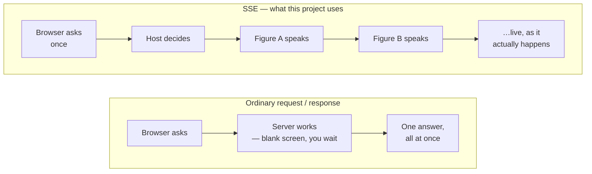

**No silent reconnect.** Browsers are helpful in a way that costs money here: the standard
streaming tool (`EventSource`) quietly *reconnects* when a stream ends — and a reconnect to a
"start a run" address starts another run. V1 hit exactly this. This project reads the stream with
`fetch()` instead, which never reconnects on its own, so a second billed run can't start by
accident. The page still closes the connection itself the moment a run reports it's over —
belt and braces.

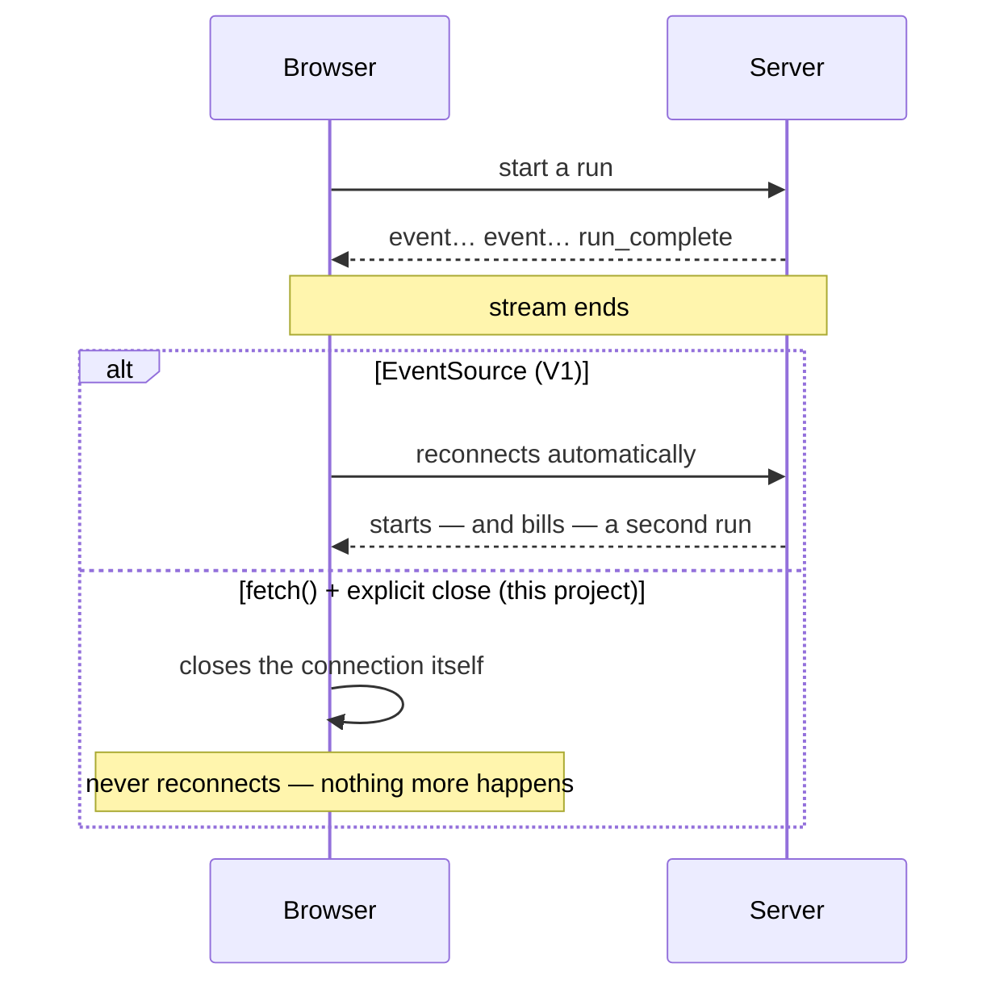

**Localhost / `127.0.0.1`.** The address that means "this computer, and only this computer."
The app listens there, so nothing on the network can reach it — useful, since a paid API key
sits behind it.

**Health check.** An endpoint whose only job is to answer "I'm up." Boring by design; it's how
you tell "the app is broken" apart from "the app isn't running."

**curl.** A command-line tool for making requests without a browser. Handy for watching a raw
event stream arrive line by line.

**Closing the tab.** Hanging up the browser cancels the stream — but on its own, not the work
behind it, which would carry on making paid model calls for nobody. So the server cancels the
work too. A call already in flight may still be billed: cancelling stops *us* waiting, not the
provider working.

> **Why it matters here:** with SSE you *watch the deliberation think*, one turn at a time. The
> live view is built only from real events as they arrive — never simulated timing.

---

## 2. What's running the code

**Uvicorn.** The program that actually runs the web server — it listens for incoming requests
and hands them on. The engine.

**FastAPI.** The framework this project's own code is written in — it defines what happens at
each endpoint. What you build *with* the engine.

**asyncio.** Python's way of doing several things at once without separate processes — what lets
four figures in hub-and-spoke reason in parallel rather than queuing.

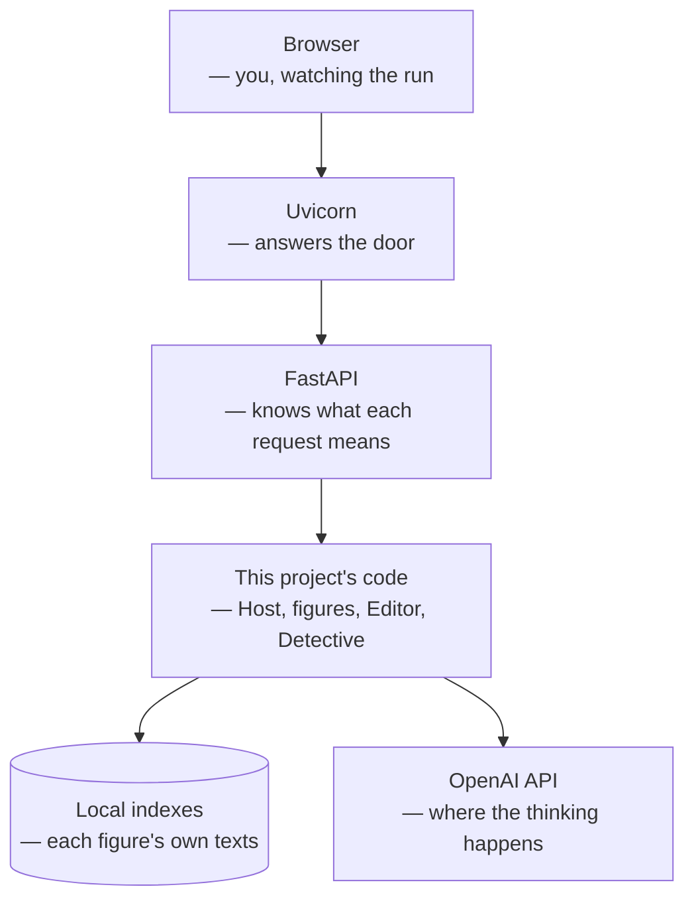

**Virtual environment (`.venv`).** A private, self-contained copy of Python just for this project,
with its own installed packages. Nothing installed here leaks into the rest of the computer, and
nothing from elsewhere leaks in.

**pip / `requirements.txt`.** `pip` installs Python packages. `requirements.txt` is the shopping
list with exact versions, so anyone can rebuild the same environment from scratch.

> **Why it matters here:** none of these layers do the *thinking* — that's the model's job. They're
> the plumbing that carries a question from the browser to the model and the answer back, and
> every hop in between is a place the trace can record.

---

## 3. Shape and safety of data

**Pydantic.** A library that enforces a fixed shape on data — "this field must be text," "this one
is required." It guarantees a figure's reply arrives in a predictable structure rather than a
loose paragraph something downstream has to guess at.

**Schema.** The definition of that shape — a contract for what a piece of data must contain.

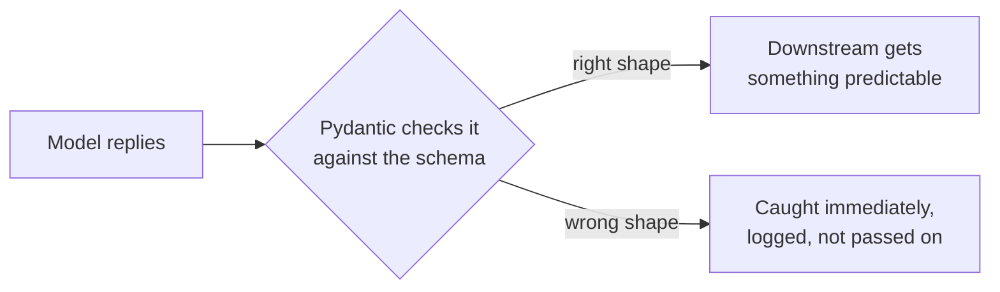

**Schema version.** A stamp on every stored record saying which version of the shape it follows,
so runs recorded weeks apart stay comparable even as the shapes evolve.

**JSON / JSONL.** JSON is a human-readable way to write structured data
(`{"role": "editor", ...}`). JSONL is one JSON object per line — so a live event stream can be
appended to without rewriting the file.

**Trace.** The complete record of one run: every decision, search, tool call, turn, failure,
token and second. In this project the trace isn't a log *about* the product — **it is the
product.** Each run gets its own folder:

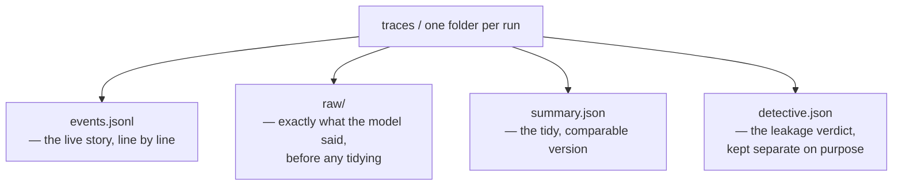

**Raw vs normalized.** Both are kept, always. *Raw* is exactly what came back; *normalized* is the
cleaned, structured version the app reasons over. Keeping raw means the app can never quietly
tidy away something the model actually said.

> **Why it matters here:** a run should be fully legible, cold, from its folder alone — what was
> asked, who answered, what they read, where they leaked.

---

## 4. The AI-specific bits

**Model.** The AI system being called. Different models have different capability and price. For
now every role here runs on the same efficient model (`gpt-6-luna`); a seat only gets a stronger
model if its trace shows it struggling.

**Token.** The unit models read and write in — roughly a word or part of one. Tokens matter twice:
they're what you're billed for, and they fill the model's **context window** — how much text it
can consider at once.

**Reasoning effort.** A dial on the model: how hard it thinks before answering, from *none* to
*max*. More effort costs more tokens and more time. With one model for every role, this dial is
what makes the Editor different from a figure.

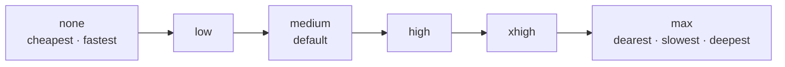

**Tool calling (function calling).** How a cloud model asks *local* code to do something
mid-thought. The model can't reach into your computer; it can only say "please run
`search_my_corpus('justice')`." Local Python runs it, hands back the result, and the model
carries on. **This loop is the single biggest new thing in V2** — V1 had no tools at all.

**`call_id`.** A ticket number on each tool request. The answer goes back stamped with the same
number, so the model knows which result belongs to which request.

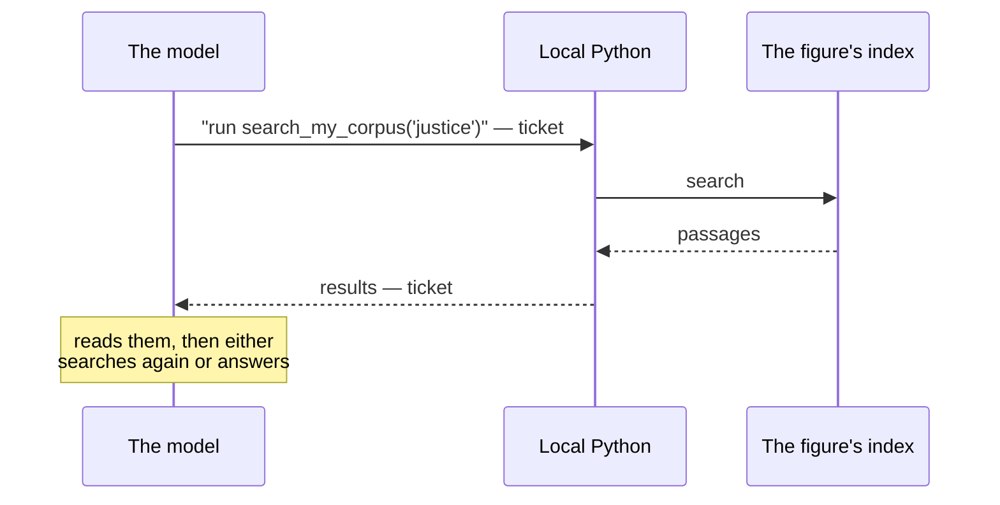

**Responses API.** The particular OpenAI interface this project uses. It's the one that supports
tool calling across the current models, so everything goes through it.

**Context growth.** Each round trip re-sends everything said so far, so the conversation — and the
bill — gets longer every step. The Phase 0 spike watched one turn grow from 89 to 165 tokens in two
steps.

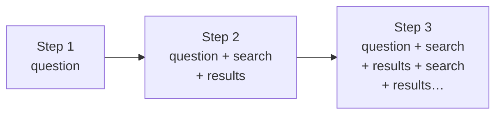

**API key vs subscription.** A subscription is a seat for a person chatting in an app. An API key is
programmatic access, billed per token, used by code. This project runs entirely on an API key.

**Project-scoped key and spend cap.** The key belongs to one project with a hard monthly limit.
If a bug ever loops, requests *fail* at the cap rather than keep spending — so a sudden error mid-run
is worth checking against the cap before blaming the code.

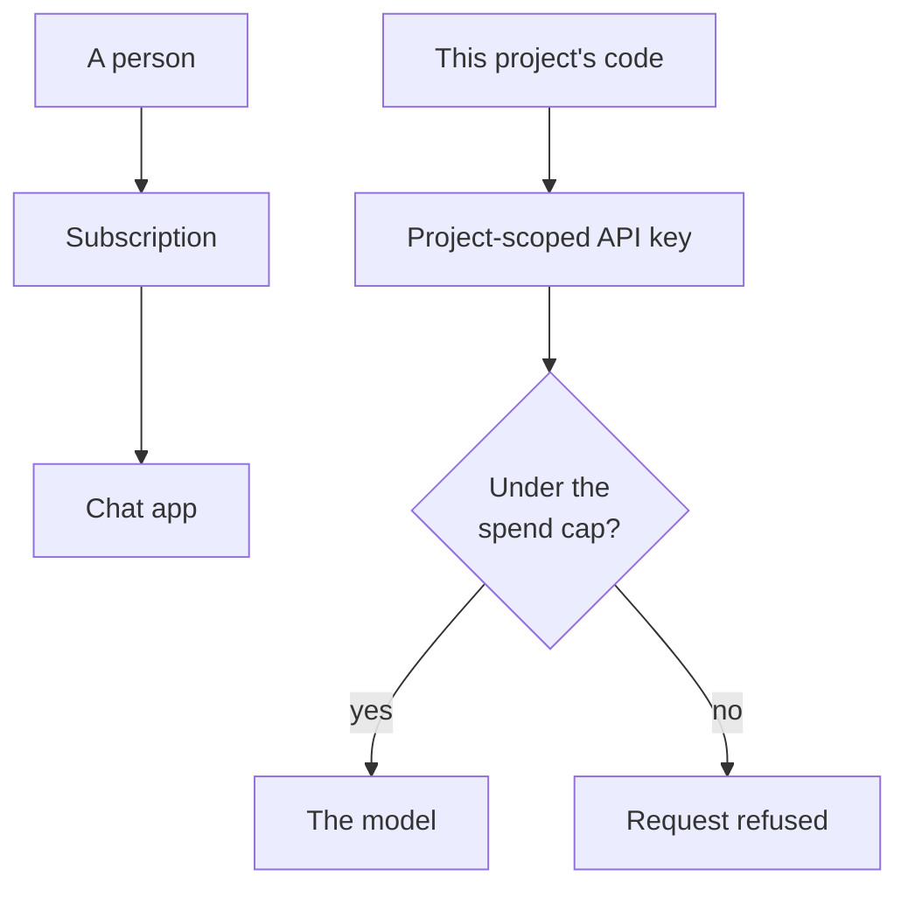

**Stateless.** Each run starts from nothing and leaves nothing behind for the next. No memory
between runs, by design — that's what makes comparing runs trustworthy.

> **Why it matters here:** the model already knows everything about every figure. Tool calling is
> the narrow door through which it's *supposed* to get its evidence — and the trace records every
> time that door opens, which is how leakage becomes measurable.

---

## 5. The retrieval machinery

*New to V2, and the heart of it.* Each figure may reason **only from its own primary sources**.
That needs a way to find the right passages in a large body of text, on demand, visibly.

**Corpus.** A figure's full body of approved primary texts — everything Marcus Aurelius actually
wrote, say. Only what's in the figure's **Corpus Manifest** counts.

**Chunk / chunking.** Splitting a corpus into retrievable pieces. Slicing every N words cuts
thoughts in half; this project splits along **natural units** instead, so every retrieved piece is
a whole thought.

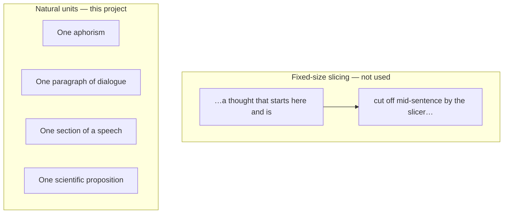

The machine-proving four were picked because their texts break apart differently: aphorisms
(Marcus), dialogue (Plato), speeches and testimony (Douglass), scientific argument (Darwin).

**Index.** A pre-built structure that makes searching fast — the index at the back of a book, built
for a computer. **Each figure has its own, physically separate index**, so one figure can never
search another's texts, by construction rather than by good behaviour.

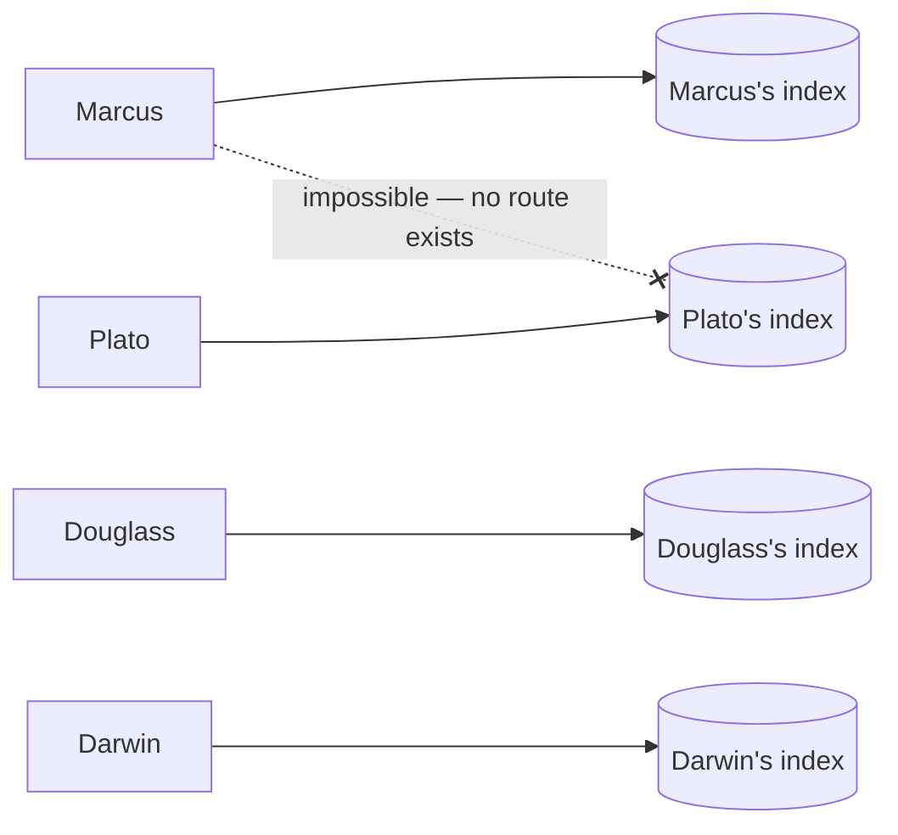

**Embedding / vector.** A way of turning a passage into a list of numbers that captures its
*meaning*, so passages about the same idea land close together even when they share no words.
The list is the **vector**; a small local program, the **embedding model**, makes them.

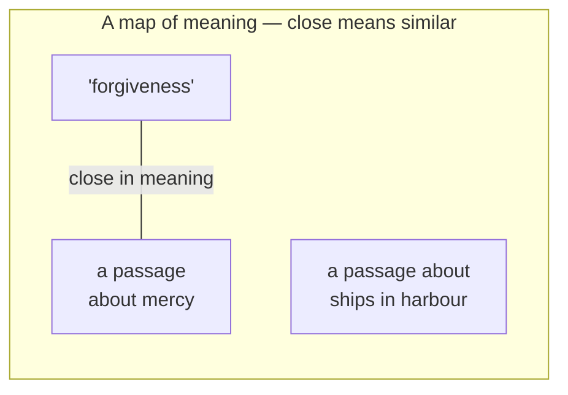

**Cosine similarity.** The measure of how close two vectors are — how similar in meaning.

**Semantic search.** Searching by meaning, using embeddings. Finds the passage about mercy when you
asked about forgiveness.

**Lexical search (BM25).** Searching by actual words — classic keyword matching, ranked sensibly.
Catches exact period terms that meaning-search can blur.

**Hybrid retrieval.** Using **both** at once, because each catches what the other misses.

**RRF (Reciprocal Rank Fusion).** The simple, no-knobs method that merges the two ranked lists:
a passage that ranks well in *either* list rises. Chosen because it's easy to explain and inspect,
unlike an opaque re-ranking model.

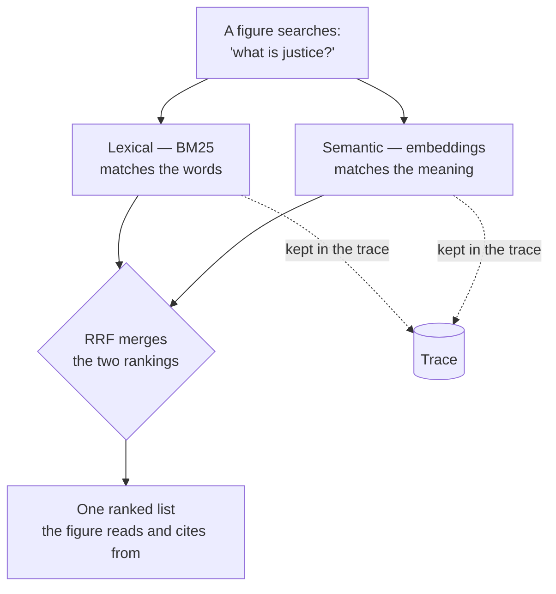

**Why both, in one real example.** In the Phase 0 spike, a figure asked about *governing one's own
mind*. A relevant passage — about judgement being ours — shared no words with the query, so a
word-only search never found it. The answer still looked complete. That's the failure hybrid
retrieval exists to catch, and why retrieval quality is measured rather than assumed.

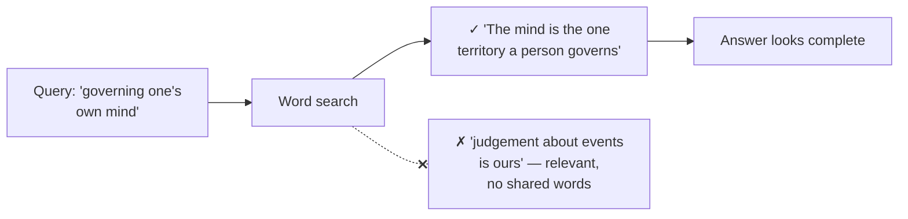

> **Why it matters here:** if a figure reasons beautifully over the *wrong* passages, that's a
> failure worth seeing — and you can only see it if the search itself is laid bare.

---

## 6. Repo mechanics

**Repo (repository).** The folder of code plus its full history, tracked by git and hosted on
GitHub. The durable record of what was actually built.

**Commit / push.** A *commit* is a saved checkpoint with a message saying what changed. A *push*
sends commits up to GitHub. ("Sync" in an editor does the push and fetches anything new.)

**Commit identity.** Every commit permanently records *who made it* — a name and an email address.
That's how a work email can end up in a public repo's history without ever appearing in the code.
This project commits under a private no-reply address GitHub provides, and GitHub is set to
**refuse** any push carrying a real address. That refusal was tested deliberately, not assumed.

**SSH key.** A pair of files that proves to GitHub "this computer is allowed to push here" without
a password. This project has its own key, used only for this repo.

**`.env` / environment variable.** A local file holding secrets, like the API key. The code reads
them at runtime; they never appear in tracked code.

**Gitignored.** Files git is told to ignore — never committed, never pushed.

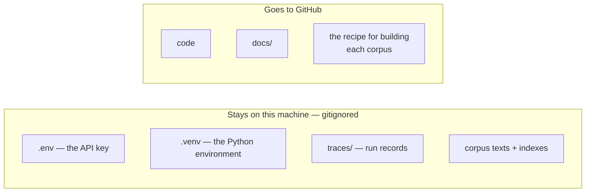

**Public vs private.** A public repo is readable by anyone; a private one only by you. This one is
public while it's being built; once public, its history — every commit, every author — is visible
to anyone who looks.

> **Why it matters here:** the repo carries the *recipe* for every corpus, never the texts, and
> never anything that identifies more than the project needs to.
