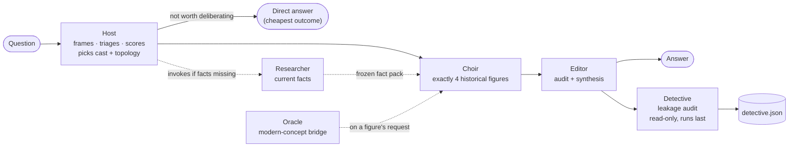
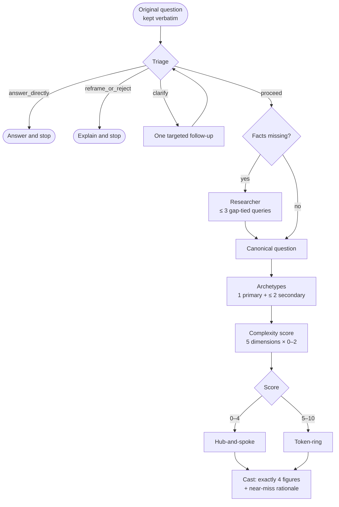
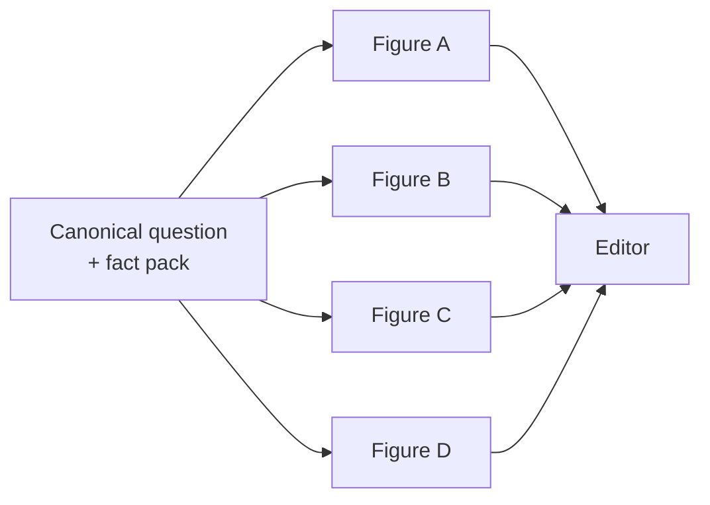
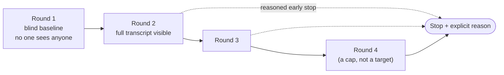
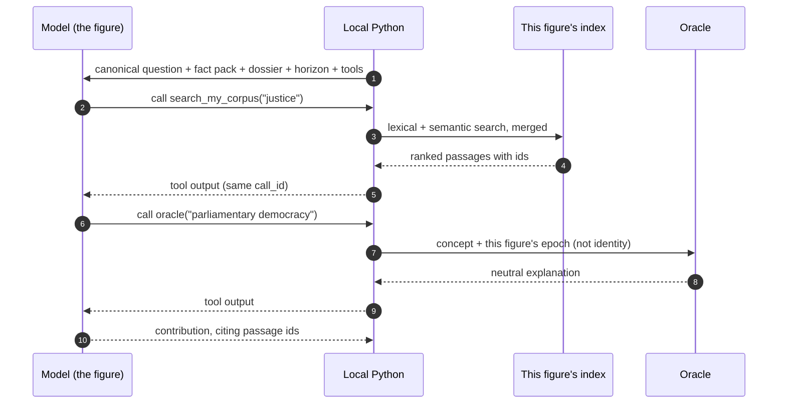
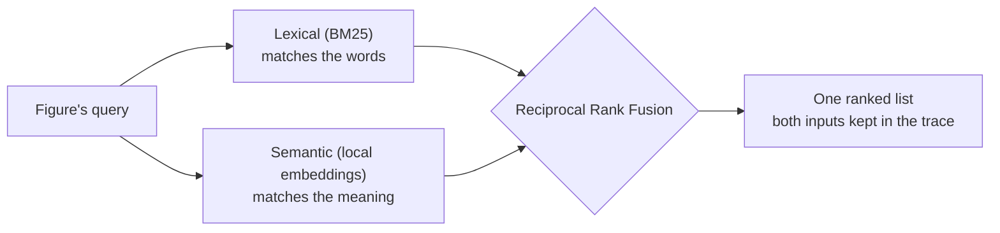
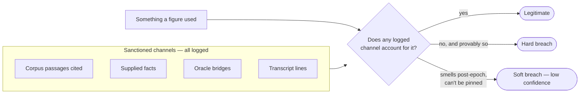

# Agent Choir Studio V2

A local, disposable learning instrument for **multi-agent orchestration, evidence-bounded
historical agents, topology effects and epistemic leakage.**

Ask it almost anything. A Host decides whether the question deserves deliberation at all, picks
four historical figures from a roster of twenty-four, and routes them through one of two
coordination topologies. Each figure may reason only from its own primary sources. An Editor
synthesises the result, and a Detective then audits the whole run for knowledge that leaked in
from where it shouldn't have.

**Not a product.** The trace is the point; the final answer is a by-product.

> **Status:** Phase 0 complete — skeleton running, live tool-calling loop proven.
> Next: Phase 1, the substrate. See [Build status](#build-status).

---

## The one idea

> **What makes LLMs powerful reasoning tools is that they know everything.
> What makes them flawed components of a system attempting near-deterministic outcomes
> is that they know everything.**

Every figure here is told: *reason only from your own retrieved primary sources, not from what
you already know about this person.* But the model underneath structurally **cannot un-know**
Marcus Aurelius or Darwin. The boundary is enforced by instruction and audit, never by
construction, so it leaks.

V2 exists to make that leak **observable**, because it is the exact constraint any real
bounded-reasoning or context-aggregation system inherits the moment it is built on a general
model. You can't prevent it. You can only decide how much to spend narrowing it, and measure
where it breaks.

> **V1 measured the deliberation. V2 measures the harness around the deliberation.**

[V1](docs/AGENT_CHOIR_LINEAGE_V1.md) held one question fixed and varied the topology. V2 lets the
question be anything, and makes the *envelope* observable: whether to deliberate, how, with whom,
and how well the reasoning stayed bounded while it did.

---

## How a run works

The visible narrative is four beats: **Host → Choir → Editor → Detective.** Two utilities sit
behind it, and the user never sees them as voices.



| Role | Does | Never does |
|---|---|---|
| **Host** | Frames the question, decides whether to deliberate, scores complexity, picks four figures and a topology | Answers the substantive question; tells the Choir why they were picked |
| **Choir** | Four figures reasoning from their own corpora, dossiers and epistemic horizons | Uses knowledge no sanctioned channel supplied |
| **Editor** | Audits the deliberation, then synthesises, attributing reasoning to figures | Becomes a fifth worldview; searches corpora; infers a figure changed its mind |
| **Detective** | Hunts for knowledge a figure used that no logged channel accounts for | Touches the answer, or anything else in the run |
| *Researcher* | Supplies current, decision-relevant facts, claim by claim | Writes essays; fabricates a missing number |
| *Oracle* | Explains a post-lifetime concept neutrally to a figure that asks | Tells the figure what to think about it |

Every run is a **closed, stateless island**. Nothing from one run enters the next.

---

## The Host: deciding how much machine a question deserves

The Host is, in effect, a **per-question resource allocator**. Its cheapest and most valuable act
is deciding *not* to run: `4 × 9` gets an answer, not a four-figure deliberation.



The five scored dimensions are value conflict, interpretive ambiguity, cross-domain interaction,
challenge value and consequence. The threshold is **locked**: no runtime override. If the rubric
routes badly, that's evidence for a future governed change, not a licence to improvise.

The Choir receives **only** the canonical question and the frozen fact pack — never the user's
wording, their own view, or the Host's reasoning about the cast.

---

## Two topologies

### Hub-and-spoke — independent, once each



No figure knows who else was selected or sees any other output. Fast, but every contradiction
between figures surfaces only when the Editor meets it alone.

### Token-ring — deliberation around a shared transcript



Seats rotate each round so no figure always speaks first or last:

| Round | Seat 1 | Seat 2 | Seat 3 | Seat 4 |
|---|---|---|---|---|
| R1 | A | B | C | D |
| R2 | B | C | D | A |
| R3 | C | D | A | B |
| R4 | D | A | B | C |

From Round 2, every turn must declare its movement — `changed_position`, `refined_position`,
`new_argument`, `new_evidence`, `direct_challenge_remains`, `no_material_change` or
`insufficient_corpus_basis` — and only a figure may declare its *own* change of mind.

> **The V1 trap, guarded.** In V1, a failed agent counted as "nothing more to add", so a
> three-way agreement plus one silenced dropout looked identical to consensus. Here, a failed
> figure is never a `no_material_change` vote. **Consensus is not truth**, and silence is not
> consensus.

---

## Inside one figure's turn

This is the keystone of the build: a cloud model that can only *ask*, and local code that
decides what it gets.



Per turn: up to **4** corpus searches, **8** candidates each, and **3** Oracle calls. Each figure
has its **own physically separate index**, so cross-figure retrieval is impossible by
construction, not by query hygiene.

Retrieval is **hybrid and visible**, because a figure reasoning beautifully over the wrong
passages is a failure worth seeing:



---

## Leakage and the Detective

The boundary isn't "no outside knowledge" — a figure needs general language just to read its
own corpus. It is **no *illegitimate* knowledge**: modern facts nobody supplied, the figure's
own later biography, post-lifetime concepts the Oracle never bridged, or knowledge of who else
is on the panel.

Every sanctioned channel is logged, so the Detective can ask a question the trace can actually
answer:



The cleanest signal is deterministic: **an out-of-horizon concept with no matching Oracle call**
is a near-certain hard breach, found by reconciling two logged lists rather than by judgement.

Every report carries a mandatory clause, because the Detective is the same kind of model as
the figures it audits:

> *Soft-breach detection is performed by a model carrying the same contamination it hunts.
> Absence of flagged soft breaches is **not** evidence of clean reasoning.*

---

## What gets measured

Seven observables per run. Two the trace reads cleanly; five need judgement, which is where the
skill lives.

| | Observable | Question it answers |
|---|---|---|
| Quantitative | **Cost** | Tokens per call, round and run |
| | **Speed** | Latency per call, round and run |
| Qualitative | **Quality** | Is the synthesis actually good? |
| | **Steering** | Were the topology and cast apt? |
| | **Question refinement** | Should we have deliberated at all, and was it framed well? |
| | **Leakage** | How bounded did figures stay, and how did the bound break? |
| | **Retrieval quality** | Did figures find and cite the *right* passages? |

Deliberately **not** scored: topology value. It's read from deltas against the Round 1 baseline.
A single "value" number would be counterfeit certainty one level up.

---

## The roster

Twenty-four figures, locked. The build is proving the machine on **four** of them, chosen for
how differently their texts are shaped, not for fame.

| Figure | Handle | | Figure | Handle |
|---|---|---|---|---|
| **Plato** ★ | Ideals | | Mary Wollstonecraft | Inclusion |
| Aristotle | Judgement | | John Stuart Mill | Liberty |
| Confucius | Harmony | | Karl Marx | Structure |
| **Marcus Aurelius** ★ | Agency | | **Charles Darwin** ★ | Adaptation |
| Sun Tzu | Position | | **Frederick Douglass** ★ | Consequences |
| Niccolò Machiavelli | Power | | William James | Mind |
| René Descartes | Doubt | | Benjamin Franklin | Experiment |
| Thomas Hobbes | Order | | Saint Paul | Transformation |
| John Locke | Rights | | Jane Austen | Character |
| David Hume | Evidence | | Friedrich Nietzsche | Genealogy |
| Adam Smith | Incentives | | Carl Jung | Depth |
| Immanuel Kant | Duty | | William Shakespeare | Human Nature |

★ **Machine-proving four:** aphorism (Marcus), dialogue (Plato), oration and testimony
(Douglass), scientific prose (Darwin) — four genuinely different chunking problems. If the
pipeline handles these, it handles most of the rest.

Each figure carries three frozen, human-reviewed artefacts: a **Corpus Manifest** (what evidence
exists), a **Persona Dossier** (how it reasons — logos, ethos, pathos) and an **Epistemic
Horizon** (what it could know without a bridge).

---

## Build status

Built in thin vertical slices. "Done" means the trace shows it, not that the code runs.

| Phase | Slice | Status |
|---|---|---|
| 0 | Bootstrap + live API spike | ✅ Done |
| 1 | Substrate: schemas, event model, trace directory, model-call wrapper | ⏭ Next |
| 2 | **Keystone:** one figure, one real corpus, hybrid index, grounded turn | |
| 3 | Oracle loop | |
| 4 | Host flow: triage, scoring, topology, cast | |
| 5 | Hub-and-spoke + Editor | |
| 6 | Token-ring | |
| 7 | Researcher + frozen fact pack | |
| 8 | Failure and degraded-run hardening | |
| 9 | Scale toward 24 (cast steering finally gets real choices) | |
| 10 | Regression set + external trace comparison | |

### What Phase 0 already showed

The spike ([`spikes/tool_loop.py`](spikes/tool_loop.py), log in
[`spikes/spike_log.txt`](spikes/spike_log.txt)) ran one figure-shaped tool loop against a
three-passage fake corpus. Small run, real lessons:

- **The model writes its own queries** — and better ones than we would. The figure chooses what
  to search; local code only executes. *Librarian, not editor.*
- **Lexical-only retrieval failed quietly on run one.** A relevant passage shared no words with
  the query, so it never surfaced — and the answer looked complete anyway. The case for hybrid
  retrieval, in miniature.
- **Consistency ≠ correctness.** Two runs wrote different queries, retrieved the same passage,
  and gave identical answers — both missing the same evidence. Stable retrieval, not good
  retrieval.
- **Context grows inside a single turn**, and each round trip costs roughly 3–5 seconds even at
  low effort. Four searches per figure, four figures, four rounds: that number compounds.

---

## Models

Model choice is configuration, never architecture.

- **Every role runs on `gpt-6-luna`** for now, with `reasoning.effort` set per role as the dial.
  A seat is promoted to a stronger model only when its trace shows it struggling — the Editor is
  the likeliest first candidate, to be tested by re-running a frozen deliberation through both.
- **Responses API only.** It's the one shape that supports tool calling across the current
  generation.
- Project-scoped key with a hard spend cap; requests fail rather than overspend.

---

## Stack

```text
Language:     Python 3.12
Backend:      FastAPI
Live updates: Server-Sent Events, hand-rolled; explicit close so a reconnect can't re-bill a run
Frontend:     Vanilla HTML + JS, no framework, no build step
Model API:    OpenAI Responses API, direct
Concurrency:  asyncio
Schemas:      Pydantic
Retrieval:    BM25 + local embeddings + RRF, one physical index per figure
Trace:        one directory per run: events, raw payloads, summary, leakage report
```

**Deliberately absent:** agent frameworks, MCP for corpus retrieval, hosted vector stores,
black-box RAG. The orchestration and retrieval loops *are* the lesson; a framework would hide
exactly the part being learned.

---

## Running it

```bash
python3.12 -m venv .venv
source .venv/bin/activate
pip install -r requirements.txt
cp .env.example .env          # then add your own API key
uvicorn app:app --reload      # http://127.0.0.1:8000
```

Right now the page streams a test run over SSE. To run the tool-calling spike against the live
API (costs a fraction of a cent):

```bash
python spikes/tool_loop.py
```

Corpus texts, built indexes, run traces and `.env` are gitignored by design. The repo carries
the *recipe* for a corpus, never the texts.

---

## Repo map

```text
agent-choir-studio-2/
  README.md
  app.py                 # FastAPI: page at /, /health, /stream (test SSE)
  frontend/index.html    # vanilla page consuming the stream
  spikes/
    tool_loop.py         # Phase 0 spike: model → tool → model round trip
    spike_log.txt        # its captured output
  docs/                  # the design pack: intent, reasoning, decisions
  requirements.txt
  .env.example
```

## Where to read next

| If you want… | Read |
|---|---|
| The map and reading order | [`INDEX`](docs/AGENT_CHOIR_V2_INDEX.md) |
| *Why* this exists | [`EXPERIMENTAL_FRAME`](docs/AGENT_CHOIR_V2_EXPERIMENTAL_FRAME.md) |
| The roles and their contracts | [`SYSTEM`](docs/AGENT_CHOIR_V2_SYSTEM.md) |
| The figures, corpora and retrieval | [`CHOIR_AND_CORPUS`](docs/AGENT_CHOIR_V2_CHOIR_AND_CORPUS.md) |
| Routing and the topologies | [`TOPOLOGY_AND_STEERING`](docs/AGENT_CHOIR_V2_TOPOLOGY_AND_STEERING.md) |
| The interesting idea | [`LEAKAGE_AND_DETECTIVE`](docs/AGENT_CHOIR_V2_LEAKAGE_AND_DETECTIVE.md) |
| What's settled and what isn't | [`DECISIONS`](docs/AGENT_CHOIR_V2_DECISIONS.md) |
| The plan and what's out of scope | [`BUILD_PLAN`](docs/AGENT_CHOIR_V2_BUILD_PLAN.md) |
| What every run records | [`TRACE_AND_INSTRUMENTATION`](docs/AGENT_CHOIR_V2_TRACE_AND_INSTRUMENTATION.md) |
| The plumbing, in plain words | [`GLOSSARY_NON_TECHNICAL`](docs/AGENT_CHOIR_V2_GLOSSARY_NON_TECHNICAL.md) |

> The code is disposable. The judgement is the asset.
