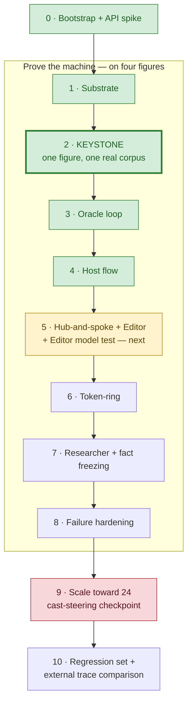
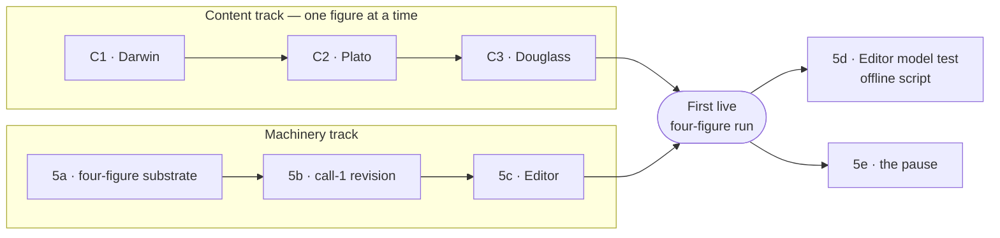

# Agent Choir Studio V2 — Build Plan

*The phased, vertical-slice build. Started greenfield; **Phases 0–1 completed 2026-11-12; Phase 2, the keystone, completed
2026-11-21; Phase 3, the Oracle, completed 2026-11-25; Phase 4, the Host, completed 2026-11-26.** Build in
thin, observable slices — each proved by trace evidence before the next begins. This is guidance with
teeth, not a rigid contract; resist building an architecture for imagined future complexity.*

---

## The governing build principle

Start from nothing and build **vertically** — a thin slice through the whole stack — not
horizontally (all schemas, then all agents, then all UI). The machine and the content are
separable problems: the orchestration/retrieval/agent code must be correct **once**, then it
serves all 24 figures identically; the corpora, dossiers and horizons are the same curation act
repeated 24 times. So prove the machine on a handful of figures first, *then* scale content
against a spec that can no longer move under it.

> **The keystone is Phase 2.** V1 gives no cover for it: V1 had no tool-calling and no retrieval
> at all. Every V2 historical turn is an agentic tool-use loop over a real local index. Prove
> that on one figure before building anything on top of it.

Green is done (the thick green box is the keystone), amber is the next slice, and red marks the checkpoint
where cast steering first produces real data. Phases 1–8 run on the machine-proving four;
content scaling waits until the machine can no longer move under it.

---

## Phases

Each phase names the slice and the **trace evidence** that proves it works — because
instrumentation is the product, "done" means the trace shows it, not that the code runs.

**Phase 0 — Bootstrap + API spike.** ✅ **Done 2026-11-12.**
Stand up the repo from commit one: FastAPI skeleton, vanilla frontend shell, `.gitignore`,
`.env.example`, README pointing at this pack, the pack itself (in `docs/`, with the non-technical
glossary at the repo root — Decisions I1), a minimal test/run path. Set the identity hygiene
(Decisions G) *before the first commit.* Then a **throwaway spike**: prove a tool-calling loop
works against the live API, and verify current model names / API surface / search & tool support
against official docs (Decisions H).
*Trace evidence:* a committed skeleton that runs; a spike log showing one real model→tool→model
round-trip.

*What landed:* identity layers set and tested before commit one (Decisions G, including a
deliberately rejected push); FastAPI app with `/`, `/health` and a test SSE `/stream`; a page
that consumes the stream and closes it explicitly, verified across two runs with no reconnect;
`spikes/tool_loop.py` and its captured `spikes/spike_log.txt`, running `gpt-6-luna` through the
Responses API against a three-passage fake corpus.

*Findings carried forward* — small run, real curriculum:

| Finding | What it means | Where it lands |
|---|---|---|
| The model wrote its own, better, expanded query | The figure chooses what to search; local code only executes | Phase 2 — confirms the tool design |
| A relevant passage sharing no words with the query was never retrieved, and the answer still looked complete | Lexical-only retrieval fails *silently* — thin evidence produces a clean-looking answer | Phase 2 — hybrid retrieval must be shown catching what lexical misses |
| Two runs: different queries, same retrieval, identical answers, both missing the same passage | Consistency across runs measures stability, not correctness | Phase 10 — cross-run comparison must not treat agreement as quality |
| Input tokens grew 89 → 165 within one two-step turn | Context compounds *inside* a figure's turn, not only across rounds | Phase 1 — log tokens per round trip within a turn |
| ~3–5 s per round trip at low effort, on tiny prompts | Up to 4 searches × 4 figures × 4 rounds compounds fast | Phases 1 and 6 — latency per round trip is a first-class trace field |

**Phase 1 — Substrate.**
Schemas, the SSE event model, the trace shape, per-role config (model **and** reasoning effort,
per Decisions H1), and the model-call wrapper built **around a tool-call loop** on the Responses
API (Decisions H2), not V1's single-shot call. The wrapper records tokens and latency for every
round trip *within* a turn, not just per turn — the spike showed that's where growth starts.
*Trace evidence:* a trivial end-to-end event stream writes a well-formed `events.jsonl` and a
`schema_version`-stamped `summary.json`.

✅ **Done 2026-11-12**, in five slices, each proven by its trace before the next began:

| Slice | What landed | Proven by |
|---|---|---|
| 1a | `Event` (trace record = SSE message); `RunTrace` writes each event *before* it's sent; `finish()` in a `finally`, so every run leaves a summary — `complete`, `failed` or `aborted` | A full run (seq 1–5, complete) and a hang-up (client saw 2 events; trace holds 3, ending `run_aborted`) |
| 1b | `core/config.py`: the one place for each role's model and effort; snapshotted into every summary at run start | Changing an effort shows in the next run's summary while earlier summaries are untouched |
| 1c | `call_model()`: async Responses-API tool loop; raw request/response per round trip, then a `round_trip` event; a loud round-trip cap | Live loop answered from a fake corpus; input tokens 89 → 167 (spike: 89 → 165); cap run stopped loudly |
| 1d | Work runs as a task that owns the lifecycle; the SSE generator only relays a live queue, and cancels the task if the client leaves | Events reach the page seconds apart, matching `events.jsonl` field for field; an abort mid-call leaves no round trip after the disconnect |
| 1e | Cache writes priced; client created at server start; one run pattern shared by browser and CLI | Cost maths checked by hand; first event's lag 381 ms → 10 ms |

*Findings carried forward:*

| Finding | What it means | Where it lands |
|---|---|---|
| A browser hang-up raises `CancelledError`/`GeneratorExit`, which bypass `except Exception` | Aborted and failed stay distinct for free — but nothing that awaits may run in a `finally` | Every run generator; Phase 8 |
| Cancelling a stream doesn't cancel the work behind it | Without an explicit cancel, a closed tab keeps making paid calls | `core/runner.py`; Phase 6 especially |
| A cancelled call may still be billed | An aborted run's recorded cost is a **lower bound** | Trace & Instrumentation §5 |
| Code between two `await`s can't be interrupted | Keeps each raw file and its event on the same seq under concurrency — an `await` between them would silently break it | Phase 5 onwards (four figures writing at once) |
| Editor at `high` reasoned for 0 tokens on an easy task | **Effort is a ceiling, not a floor** (Decisions H1) | Phase 5: confirm reasoning-token pricing on a real Editor call |
| Client setup did ~270 ms of blocking work inside the first run | The blocking trap, in miniature; found by the trace | Fixed (lifespan); a pattern to watch for any one-off setup |
| Usage could report impossible token slices | Cost estimation raises rather than misprices | Phase 8 |

**Phase 2 — KEYSTONE: one corpus, end to end.**
Take one machine-proving figure. Acquire → structure-aware chunk → build BM25 + vector + RRF
index → expose the retrieval tools → run **one figure doing a real corpus-grounded agentic turn**
with the full retrieval trace visible.
*Trace evidence:* for one turn, the trace shows the search query, lexical candidates, semantic
candidates, merged/ranked results, passages opened, passages cited — and a contribution grounded
in real cited passages. It should also include at least one case where the semantic list surfaces
a relevant passage the lexical list missed — the Phase 0 failure, now caught. If this feels right,
everything downstream is assembly.

✅ **Done 2026-11-21**, in six slices on Marcus Aurelius, each proven before the next began:

| Slice | What landed | Proven by |
|---|---|---|
| 2a + 2b | Gutenberg #15877 (Long), SHA-256 pinned; Long's apparatus stripped, including 127 footnotes matched by label; one chunk per numbered section | Deterministic chunks; no section-number gaps; zero contamination hits |
| 2c | Hand-written BM25: Snowball stemming, internal apostrophes kept, per-term breakdown (surface form, tf, IDF, contribution) | Hand arithmetic matched to 5 dp; "governing one's own mind" reaches I.1 via *government → govern* |
| 2d | B4 resolved: `bge-small-en-v1.5` via `sentence-transformers`, pinned revision, every setting asserted at load; `max_words` 380 plus a semicolon fallback; vector cache keyed on content and model | 0 of 504 chunks over 512 model tokens; self-match at cosine 1.0; a stale cache names the key that changed |
| 2e | RRF (k 60, depth 8); per-turn bound tools with budgets enforced in code; `corpus_search` events naming raw candidate lists; embedding and retrieval config in the run snapshot | RRF hand arithmetic to 6 dp; three refusals logged and the run still `complete`; no route to another figure's data |
| 2f | Structured contribution; stand-in prompt (not a dossier, E1); deterministic citation checks; three live turns | 9 calls, ~$0.0015 in total; every citation opened first; **V.36, surfaced only by the semantic list, opened and cited** |

*Owner judgements recorded* — the trace can show what was retrieved; only a reader can say what
is relevant:

- **IX.15 is relevant** to "governing one's own mind" (2d): no BM25 match, vector #5. With I.1 —
  BM25 #7, vector #319 — it is the first entry for the Phase 10 regression set.
- **Run 1's four citations each support their claims** (2f): the first human-verified grounded turn.
- **Run 2's `grounded` is fair** (2f): "I cannot prescribe a financial strategy from these writings"
  is the evidence boundary working, and the move into the nature of wealth is a legitimate extension.

*Findings carried forward:*

| Finding | What it means | Where it lands |
|---|---|---|
| The possessive remnant `s` (df 61) carried IDF ≈ 2.1 | Rarity weighting only suppresses junk that is *common*; tokeniser choices need probing on real text | Fixed in 2c; Phase 9 for every corpus |
| The library's recorded model revision only echoes the requested string | A check against an echoed value verifies nothing | Revision read from the commit-named cache folder; a pattern for every verification |
| One 420-word sentence (I.17) measured 523 tokens; restoring 380 words also split IX.9, X.8 and X.33 | Chunk limits come from the model, but the word rule stays model-independent, with a token gate at embed time | Phase 9 chunking per corpus |
| Archaic forms split into misleading pieces (*doth* → `dot` + `##h`) and never match modern forms lexically | Period English costs on both retrieval paths | Retrieval quality, Phase 9 |
| Dropping the query instruction moves ranks materially (IX.15 #5 → #1, X.2 #8 → #24) | A silent setting with real effects; kept as documented (B4) | Phase 10 regression set |
| The vector top 8 spans ~0.03 cosine; the 14-word I.1 ranks vector #319 | Cosines carry little meaning beyond rank; very short chunks embed weakly; each path misses what the other finds | Supports RRF on ranks; Phase 9 chunking |
| With 8 merged slots, RRF gives each list ~4 unless items appear in both; deeper lists crowd out single-path catches (2 → 1 → 0 at depths 8 / 15 / 30) | Depth 8 chosen on that evidence | `core/config.py`; re-test against the regression set |
| IX.15 surfaced twice (semantic-only, #7 and #5) and was never opened | A catch can be lost at every stage: retrieved → merged → previewed → opened → cited, and the trace shows which | The figure's open decision is unexplained at low effort (0 reasoning tokens); Phase 10 |
| The figure's queries come from prior knowledge (Stoic vocabulary; "Book 4 Book 6 Book 11") | Memory steers retrieval before any claim is made | Leakage & Detective: distinguish memory used to *search* from memory used to *assert* |
| One search, four opens, zero reasoning tokens in every run at `low` | **Effort is a ceiling** again: the figure stops at *enough*. Not yet evidence of struggling (H1) | Watch from Phase 5, when topology asks more of a figure |
| Runs 1 and 3 shared 7 of 8 merged results and 3 of 4 citations | Stability, not correctness (the Phase 0 warning) | Phase 10 |
| `insufficient_corpus_basis` has no definition: the figure self-assesses "not enough" | Statuses consumed downstream need a checkable criterion, not a qualitative call | **OPEN** — Phases 4–5 (Host framing, Editor disposition) |
| Run 2 answered a neighbouring question and the schema cannot say so | The frame belongs upstream, not in a third figure status | Phase 4 |

*Parked for later phases:* `call_model`'s events carry the role (`figure`) but not which figure —
needed before Phase 5 runs four at once; OpenAI's default response storage is on, and turning it
off changes how reasoning items pass between round trips — revisit before the Researcher
(Phase 7); figure and embedding loads are synchronous — move them off the event loop when the
server runs figures.

**Phase 3 — Oracle loop.**
Add the private Oracle to that one figure: horizon-triggered, budgeted, declared in turn state.
*Trace evidence:* a turn where the figure hits a post-horizon concept, requests a bridge, and the
Oracle call + its effect on reasoning appear in the trace with the corpus-search budget untouched.

✅ **Done 2026-11-25**, in four slices on Marcus Aurelius:

| Slice | What landed | Proven by |
|---|---|---|
| 3a-i | Horizon machinery: shared concept *lineages* of era-specific *senses*, a per-figure *profile*, a deterministic compiler (available / beyond by date / unreached), breach terms, source-hash staleness (Decisions E1) | Hand-computed toy values, including a later sense from another tradition landing in *beyond*; six rejections with clear messages |
| 3a-ii | Marcus's Horizon: 7 traditions, 15 lineages, 58 senses, each sourced; terms matched by stem through BM25's own `analyse()`; `find_breaches()`; an offline coverage probe (`builder` role) | v1 seed left 24 of 34 extracted modern concepts unmapped; after stem matching and evidence-driven content, fresh unseen answers left 11 of 44 |
| 3b | The Oracle as a bound tool: deterministic Horizon lookup, composed input (Decisions C5), name redaction, structured answer, 3-per-turn budget, failure that never fails the figure | 6 live bridges, $0.0014, all `bridged`; the budget refusal shown in the live run (refused before any call); redaction and `repeat_of` shown offline; the simulated failure in both |
| 3c | Oracle wired into the figure turn; prompt guard (Decisions E3); deterministic reconciliation; Horizon-in-prompt run as an A/B | 6 turns, 35 calls, $0.0053. Q1 A asked the Oracle about "phone" before searching; all 5 uses traced to the question and bridge 1; search budget untouched |

Phase 3 live calls in all: 65, about $0.018.

*Owner judgements and contributions recorded:*

- **The Horizon as a shared concept tree** — the owner's proposal, with epoch-grounded senses
  (Galen's circulation, not Harvey's) and access by milieu rather than by corpus. It replaced
  per-figure Horizon lists.
- **"Is it exhaustive enough?"** — the owner's challenge that produced the coverage probe; and the
  owner's catch that the first milieu foregrounded Galen only because the conversation had.
- **The six Oracle explanations are faithful and neutral.** In review, the SSRI bridge read as the
  weakest: it anchors on the humours and opium, not on Galen's own teaching about the nerves.
- **Phase 3 works as intended.** The Q2 answers were *not* read line by line against their bridge,
  so their zero unbridged hits are a method result, not a verified clean (finding below).

*Findings carried forward:*

| Finding | What it means | Where it lands |
|---|---|---|
| Splitting unavailable senses by tradition would make every modern sense "unreached" for a single-tradition figure | Split by date: *beyond* = after the horizon year, anywhere; *unreached* = existed, but not for this figure. Tea (Han China) is the first real unreached sense | `epistemic/horizon.py` |
| While drafting, before the first commit, the first compile flagged 18 ordinary words as modern — among them "nerves" (Galen), "engagement", "interest rates", "usurer", "division of labour" (removed before commit, so not in repo history) | A word modern in one sense is often ancient in another; breach terms must be checked word by word | Every figure's Horizon review, Phase 9 |
| A seed written from imagination left 24 of 34 extracted modern concepts unmapped; evidence-driven content brought fresh answers to 11 of 44 | Seed from evidence, not invention. Several remaining gaps are old words in new senses ("dependence", "alerts"); others are simply unmapped ("clinician", "windfall gains") | Coverage probe per figure, Phase 9 |
| Exact matching missed inflections ("apps", "SSRIs"); acronym plurals don't stem ("SSRIs" stays `ssris`); the tokeniser drops digits | Terms match by stem through BM25's own `analyse()`; acronym plurals are listed in content; terms with digits are rejected | `epistemic/horizon.py` |
| The identity flag catches names, not descriptions: "as one who has ruled Rome these many years" passes; before redaction, a flagged name would have been sent (the only named request ran against a patched call) | Names are redacted to "[name]" in what is sent; descriptions cannot be, so "epoch, not identity" stays a soft barrier | Decisions C5; System §7 |
| No answer came back `cannot_bridge`, not even quantum entanglement | The Oracle's honesty lives in `left_out` more than in refusing | Watch from Phase 5 |
| A bridge hands the figure further modern terms (the SSRI bridge introduced "serotonin", a breach term) | A bridge sanctions every term in the explanation received, not only the concept asked | `choir/reconcile.py` |
| The Horizon's own summary would have put "investors" into the figure's prompt; the guard, specified in the 3c brief, caught it before any run | Our instruments leak too; no figure prompt may contain a breach term | Decisions E3 |
| Q2's request about anxiety as a medical illness looked up as `his` (anxiety is Cicero's word): the Oracle got no sense block, and term matching found nothing in his answer | Old word, new sense, at the lookup layer. A request for a modern sense of one of his words is itself the signal | Parked: `his` lookups send his sense **and** the lineage's later senses |
| Two of condition B's three Oracle requests quote the B block back (Q2 "bodily melancholia"; Q3 debasement); B also searched more (8 searches against A's 4). One run per cell | The seed's wording visibly primes the figure; one run per cell cannot separate the rest from noise | **OPEN** — Decisions E1 |
| "Bridge unused" requires the whole concept phrase to recur: Q3 B's concept, "prices rising and profit from price changes", would need all seven stems in order | Measure uptake by reuse of the explanation's distinctive terms | Parked for the Detective |
| The $0.05 stop for the 3c runs failed silently: it lived in a shell loop | Spend caps belong in the runner, in code | Phase 8 |
| Marcus asked the Oracle before searching (Q1); every turn reasoned for 0 tokens at `low` | The prompt's ordering shapes the turn; effort is a ceiling, again | Watch from Phase 5 |

*Parked for later phases:* `his` lookups to carry the lineage's later senses; uptake measured by
explanation terms; spend caps in the runner (Phase 8); a **human-readable Detective report**
rendered from `detective.json` (Leakage & Detective §8); marker-level checking — a candidate is
cosine similarity between a figure's sentences and marker claims using the local embedding model,
to be tested when a trace shows a marker-level leak; the Q2 answers read line by line against
their bridge.

**Phase 4 — Host flow (no Choir yet).**
Framing → triage → archetype → complexity score → topology → cast selection, all rationale to
trace/UI. Cast selection runs degenerate on four figures (selects all four) but emits full
rationale and near-miss structure.
*Trace evidence:* a maths question triaged to `answer_directly`; a real question scored per
dimension with a topology chosen from the locked threshold, and the decision record visible.

✅ **Done 2026-11-26**, in three slices and a calibration. The Host is three structured-output calls
with code between them: **the model judges; code enforces** (Decisions J1). Each call sees only its
own inputs (J2).

| Slice | What landed | Proven by |
|---|---|---|
| 4a | Call 1, triage and framing: four outcomes, each filling only its own fields (code-checked); canonical question and answer criterion (J3); factual posture and gaps, with research need derived in code; `ChoirInput` as the only type that will cross to the Choir; a tripwire on Host vocabulary in the canonical question (J4) | 4 live calls, $0.00087: 17 × 23 → `answer_directly` (391); "How should a person govern their own mind?" → `proceed`; "Should I take the offer?" → `clarify`; "What will the FTSE 100 close at next Friday?" → `reframe_or_reject`. 12 offline cases |
| 4b | Call 2, on the canonical question only: decomposition (single / compound / nested, cycles rejected), one primary and up to two secondary archetypes, five dimensions per unit with the rationale before the score. Code sums, takes the highest unit, applies the threshold and writes the rule (`governing total 6 ≥ 5 → token_ring`); the model has no field for any of it | Boundary 4 → hub-and-spoke, 5 → token-ring, offline; a stability probe of 3 runs per question; one end-to-end run in the browser |
| 4b calibration | Rubric anchors drafted, then calibrated against two blind readers (owner and Claude, Claude's scores sealed before the owner scored); `host_score.md` v2 (J8) | v1: three of the owner's questions scored 5 / 5 / 2 by the owner and 9 / 9 / 7 by the model, every run. v2 on fresh questions: beauty matched the owner exactly on 2 of 3 runs; cross-domain inflation fell from 2 almost everywhere to mostly 0 or 1 |
| 4c | Call 3, on the canonical question, the archetypes and the roster only: every figure assessed before selection (archetype relevance, question fit, corpus suitability), exactly four selected, the panel described. Code records `would_reject`, `gate_unassessable` and `gate_not_applied` (J6) | 6 live calls, $0.0028: Marcus's corpus `strong` for self-governance and `weak` for aesthetic form → `would_reject: ["marcus_aurelius"]`; Darwin `weak` on relevance and fit for self-governance. 43 offline cases; call 3's real request is inspected on every run that makes it, and separate in-memory runs showed the inspection catches three injected leaks |

Phase 4 live calls in all: 53, about $0.024.

*Owner judgements and contributions recorded:*

- **The gate as a prediction, not a shrink.** The owner challenged "four, come what may": if the
  corpus doesn't fit, isn't that telling us something? Kept at exactly four (locked), but the gate's
  verdict is now recorded as `would_reject` and tested against retrieval in Phase 5 (J6).
- **Value conflict means the broad middle.** On the scope of government: "the man in the street with
  another man in the street finds common ground." Tradition-level clash goes to challenge value,
  which stops the same disagreement scoring twice (J8).
- **A domain is a field, not a topic.** The owner read "mental health" as one domain; Claude read
  fact and value as two. Neither reading discriminates; the anchor now counts fields of knowledge.
- **The author doesn't see their own ambiguity.** "Natural law" meant the laws of physics to its
  author; call 1 asked whether it meant moral law. Scoring is the Host's, on the canonical question.
- **Not the arbiter.** "I'm not a supremely qualified ultimate arbiter of this": calibration targets
  convergence between independent readers, and the real test of a routing is topology value in
  Phases 5–6 (A3).
- **Owner verdicts:** all four 4a outcomes right; the 4a answer criterion follows from its canonical
  question with no framing in plain words; 4c's `weak` ratings warranted.

*Findings carried forward:*

| Finding | What it means | Where it lands |
|---|---|---|
| Stable but miscalibrated: v1 scores were identical across runs and consistently above the owner's | Stability is not correctness, again (Phase 0) — now in the Host's own routing | Calibration (J8); the question-bank sweep, parked |
| A model satisfies a naming rule with something that isn't the answer: the cross-domain "name the reversal" test was met with a "mistaken intuition" and with a hypothetical | Rules a model can satisfy by naming are weak constraints | Watch in the sweep |
| Decomposition is not deterministic: "Are pornography and sex work immoral?" came out compound, single, compound | Totals and topology held; unit counts did not | Watch; unit wording is also unchecked ("Are pornography immoral?") |
| On moral questions the model reads "immoral" as ambiguous and challenge value as high; the owner does not | A genuine difference in reading, which two human readers also show; more wording won't settle it | Recorded, not tuned |
| Call 1 widened a question: the entropy question gained "why did the universe begin in a low-entropy state?" | Breaks "resolve wording, not substance", and in one of three scoring runs the added clause became the governing unit (topology unaffected): a triage drift can become a routing drift | Phase 5, with the clarify design |
| Clarify asked for the user's values ("what matters most to you"), and asked two things at once (twice) | A leak path: in Phase 5 a clarification shapes the canonical question, the one thing the Choir sees | Phase 5 clarify design: facts of the situation only; never the user's view |
| Triage deflects the modest questions: the chicken and the commodity question were both answered directly | The low end of the scoring rubric matters less than expected; the case that matters is the modest but deliberable question | Calibration scope |
| The hard triage reasoned more (476 reasoning tokens on the FTSE question against 19–51) | Effort is a ceiling, seen from the other side | Phase 4 evidence for H1 |
| Prompt caching appears only when the stable prefix is long enough: call 2 (~1,400 tokens) cached; call 1 (~830) never; call 3's stable prefix is short because the question precedes the roster | Cacheability depends on prefix length and order | Parked: put the roster before the question in call 3 |
| Archetype relevance can ride a broad label: Douglass `strong` for aesthetic form through Social / Cultural | A broad archetype carries a figure the question doesn't | Phase 9, when cast steering is real |
| No archetype for aesthetics: beauty was classified Scientific / Epistemic every time | A gap in the eight | Note for Phase 9 |
| The Host's model calls take 19–24 s before any deliberation (24 s on a two-call run whose call 2 took 17 s on a four-unit question; 19–21 s on the three-call 4c runs) | The slowest single step built so far | H1 evidence |

*Parked for later phases:* the in-run pause (built once in Phase 5 for the correction boundary, then
reused for clarify and "what do you think?", J7); call 3 caching order; `gate_not_applied` must
depend on whether an unselected figure was available (Phase 9); a `conceptual` value for factual
posture (metaphysics is forced into `normative`; Phase 7); first-person canonical questions ("Should
I…") for the Phase 5 canonical review; `GET /stream/live` still spends money on a GET; an offline
**question-bank sweep** — a naive generator ("if you could put any questions to a panel of historical
figures…"), the Host run over the bank, reporting topology distribution, stability and decomposition,
**never** used as a calibration reference and never fed back; the **deliberation view** (a chat-like
layout of our own design that never shows a figure seeing what it doesn't: hub-and-spoke as four
private rooms, token-ring round 1 sealed, the Oracle as a private thread, the Host in its own pane;
real cited passages as each figure's voice; no invented quotations; portraits or line drawings, open);
and a **full run report**, rendered by code from one trace with no model call, downloadable as one
self-contained HTML file — replacing the parked "human-readable Detective report".

**Phase 5 — Hub-and-spoke + Editor.**
Wire the four figures in parallel (each independent, private Oracle, no cross-talk), persist the
four as the independent baseline, then the Editor's audit + synthesis.
*Prerequisites, from Phase 4:* corpora, Manifests and compiled Horizons for Plato, Frederick
Douglass and Charles Darwin — Marcus's exist; Darwin's corpus recipe is built (C1), his compiled
Horizon is not. *Moved in from Phase 4:* the in-run pause, built
once, first for the user correction boundary (Topology & Steering §2), then reused for the clarify
loop and "Before we go on, what do you think?" (Decisions J7). Phase 5 may need to split.
*Trace evidence:* a full hub-and-spoke run; four independent contributions; an Editor synthesis
with disposition label, attribution, distinguished modern/historical citations, and "What would
change the answer?"; a genuine (unstaged) satellite failure handled per the degraded-run rule if
one occurs. Then the **Editor model test** (Decisions H1): the same frozen deliberation
re-synthesised on a stronger tier, the two syntheses compared side by side, and the promotion
decision recorded either way. Also confirm, on the first Editor call that reports
`reasoning_tokens > 0`, that its estimated cost counts reasoning inside output tokens and not on
top — left open in Phase 1, where the demo task was too easy to make the model reason.

*Plan, agreed 2026-11-26 (Decisions K1–K8). Status 2026-11-27: 5a, 5b and 5c are committed; C1's
corpus is done; nothing else below is built.* Two tracks meet at the
first four-figure run; the machinery is tested offline until all four corpora pass the token gate.

| Slice | What it adds | Decisions |
|---|---|---|
| C1–C3 | Darwin, Plato, Douglass: corpus recipe offloaded, verified, token-gated; profile, lineages, compiled Horizon, coverage probe; roster flips to `built` | K3–K5 |
| 5a | Per-figure event labels; loads off the event loop; `figure_turn` takes `ChoirInput`; `Contribution` schema 2; four concurrent, isolated turns with one logged retry and the degraded / hard-fail rule; the independent baseline persisted; `topology_not_built` for token-ring routings | K1, J10 |
| 5b | One call-1 prompt change: third-person canonical question with situation facts, no widening, one-fact clarify; single-`?` checks in code | K6 |
| 5c | The Editor: composed input, `audit` before `synthesis`, code checks; the first live hub-and-spoke runs | K7, C3 |
| 5d | The Editor model test (H1, H3): the same frozen Editor input on a stronger tier, scored blind side by side, the promotion decision recorded either way | H1 |
| 5e | The in-run pause: correction boundary, then clarify, then "what do you think?" | K8, J7 |

The figures run on the revised stand-in prompt with no own-era Horizon block (K2). The 5e pause
comes last only in order of building: nothing upstream depends on it, and it changes the run
lifecycle once that lifecycle holds four figures.

*Recorded during 5c design (2026-11-26), not yet scheduled:*

- **The Detective has no phase.** Its design is in Leakage & Detective; no phase of this plan builds
  it. It depends on the Editor and runs last in every run (C4), so its natural place is a slice
  straight after 5c/5d. To be settled at the Phase 5 checkpoint.
- **The full run report opens with the question and a scorecard** (owner's requirement): one tile
  per observable, each coloured red / amber / green by a rule in code from a fact in the trace —
  run status, cost and speed against a budget, retrieval discipline (citations never opened,
  declarations without a search), the Editor's evidence verdicts, the Detective's findings by
  grade, gate predictions and steering checks, counterfeit consensus — **with the rule that
  coloured it shown on the tile**. Qualitative observables show their signals coloured and
  labelled *signal, not verdict*; quality itself is shown uncoloured, as "read the synthesis",
  linked to the audit. **No overall run colour and no quality colour** (A3, Topology & Steering
  §13: a scalar quality score is counterfeit certainty one level up). Thresholds are decisions,
  recorded and versioned like rubric anchors.

*C1 note (2026-11-27):* Darwin's corpus is done — recipe landed, rebuilt byte-identically, token
gate passed, roster flipped to `built` (Decisions K3). His profile, lineages, compiled Horizon and
coverage probe are pending.

*Parked at C1 (2026-11-27):*

- **The Horizon gap.** Darwin is `built` in the roster with no compiled Horizon: no live run may cast
  him until it is compiled (Decisions K3).
- **A guard for it,** for the Phase 5 checkpoint: refuse to cast a built figure with no compiled
  Horizon.

**Phase 6 — Token-ring.**
R1 blind baseline → later rounds seeing the transcript → direct-question/challenge objects →
deterministic seat rotation → deterministic stop logic **with the failed-figure guard** (a failed
figure is not a `no_material_change` vote).
*Trace evidence:* a run reaching reasoned early stop with an explicit stop reason; seat order
persisted per round; a direct question blocking termination until answered; per-round context
growth and cost visible.

**Phase 7 — Researcher + factual freezing.**
Pre-panel research (≤3 gap-tied queries, source hierarchy, distilled fact pack), the frozen
substrate, and the one exceptional Host-approved token-ring intervention.
*Trace evidence:* a question that triggers research; the distilled fact pack shown before
deliberation; provisional-vs-final complexity score with the reason for any change.

**Phase 8 — Failure/degraded hardening.**
The full taxonomy: one-retry, 1-figure-degrades / 2+-hard-fails, structural-role hard-fails,
`cannot_access_corpus` vs `insufficient_corpus_basis`, Oracle-failure continuation.
*Trace evidence:* deliberately induced failures each producing the correct run outcome and a
legible trace.

**Phase 9 — Scale toward twenty-four.**
Corpora, Manifests, Persona Dossiers, Epistemic Horizons for the remaining figures. Content work,
parallelisable, the real long pole. **This is the cast-steering activation checkpoint:** the
moment the roster crosses ~8–10 figures, the Host must genuinely *choose and reject*, and cast
steering (observable 4's second half) produces real data for the first time. Mark and write up
the first runs where the Host rejects relevant figures and must justify it — this is a distinct
milestone, not blurred into "scaling the corpora."
*Trace evidence:* runs where the selected four differ by question, with near-miss rationale that
holds up.

**Phase 10 — Regression set + external analysis.**
An 8–12 question internal benchmark (both topologies, archetype families, nested/compound,
clarification-required, quantitative dependency, likely anchoring, likely counterfeit consensus,
insufficient-basis, modern-concept-requiring-Oracle). Then — and only then — a **trace-comparison
utility that lives entirely outside runtime** (Host drift, cast/topology stability, retrieval
variation, leakage distributions across completed traces). It never feeds back into runtime.

---

## Out of scope (do not build; do not let a helpful collaborator add)

Grouped by *why* each is out — the reason is what makes the exclusion stick.

**Would contaminate the experiment's cleanliness:**
- self-improving / compounding loop (named as a future build, deferred on purpose);
- cross-run state of any kind (no memory, no cast/topology carryover);
- user override of cast or topology (the Host's routing is the thing under study).

**Would hide the mechanism being learned:**
- agent frameworks (LangChain, OpenAI Agents SDK, CrewAI, …);
- MCP for corpus retrieval;
- hosted vector stores;
- black-box RAG pipelines.

**A different experiment or a later phase:**
- the full 24 corpora up front (machine-proving four first);
- the external trace-comparison utility *as part of runtime* (it is post-hoc, Phase 10, outside
  the run);
- purpose-trained SLMs (named in the mitigation hierarchy, not attempted);
- cross-checking-LLM verification passes (named as a mitigation tier, not built — V2 studies
  leakage via the Detective rather than suppressing it via redundant passes).

**Not what this instrument is:**
- production anything (no auth, rate-limiting, abuse-hardening, multi-user, "survives a stranger");
- real system integration (Workday/D365/ServiceNow/M365 — the Researcher *simulates* external
  retrieval; corpora are static local files);
- corpus texts in the public repo;
- any corporate identifier in contents, commit metadata, key comments or config.

---

## How to work through this (working method)

From the build posture, carried into how the pack itself was produced:

- explain the concept before the abstraction; show the mechanics before the code;
- make decisive recommendations; name the rejected alternative; do not offer a menu unless the
  fork genuinely belongs to the owner;
- surface gotchas rather than smoothing them over — when something fails interestingly, that is
  curriculum;
- keep code legible and local; avoid premature abstraction; do not dump huge finished files
  unless asked;
- one concept or vertical slice at a time;
- when behaviour changes, state what trace evidence will prove it works.

> **Instrumentation over answers.** The final answer is useful. The trace is why we are here.
