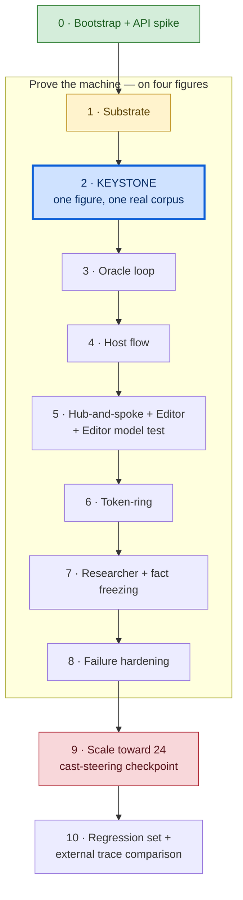

# Agent Choir Studio V2 — Build Plan

*The phased, vertical-slice build. Started greenfield; **Phase 0 completed 2026-11-12.** Build in
thin, observable slices — each proved by trace evidence before the next begins. This is guidance with
teeth, not a rigid contract; resist building an architecture for imagined future complexity.*

---

## The governing build principle

Start from nothing and build **vertically** — a thin slice through the whole stack — not
horizontally (all schemas, then all agents, then all UI). The machine and the content are
separable problems: the orchestration/retrieval/agent code must be correct **once**, then it
serves all 24 figures identically; the corpora, dossiers and horizons are the same curation act
repeated 24 times. So prove the machine on a handful of figures first, *then* scale content
against a spec that can no longer move under it.

> **The keystone is Phase 2.** V1 gives no cover for it: V1 had no tool-calling and no retrieval
> at all. Every V2 historical turn is an agentic tool-use loop over a real local index. Prove
> that on one figure before building anything on top of it.

Green is done, amber is next, the thick blue box is the keystone, and red marks the checkpoint
where cast steering first produces real data. Phases 1–8 run on the machine-proving four;
content scaling waits until the machine can no longer move under it.

---

## Phases

Each phase names the slice and the **trace evidence** that proves it works — because
instrumentation is the product, "done" means the trace shows it, not that the code runs.

**Phase 0 — Bootstrap + API spike.** ✅ **Done 2026-11-12.**
Stand up the repo from commit one: FastAPI skeleton, vanilla frontend shell, `.gitignore`,
`.env.example`, README pointing at this pack, the pack itself (in `docs/`, with the non-technical
glossary at the repo root — Decisions I1), a minimal test/run path. Set the identity hygiene
(Decisions G) *before the first commit.* Then a **throwaway spike**: prove a tool-calling loop
works against the live API, and verify current model names / API surface / search & tool support
against official docs (Decisions H).
*Trace evidence:* a committed skeleton that runs; a spike log showing one real model→tool→model
round-trip.

*What landed:* identity layers set and tested before commit one (Decisions G, including a
deliberately rejected push); FastAPI app with `/`, `/health` and a test SSE `/stream`; a page
that consumes the stream and closes it explicitly, verified across two runs with no reconnect;
`spikes/tool_loop.py` and its captured `spikes/spike_log.txt`, running `gpt-6-luna` through the
Responses API against a three-passage fake corpus.

*Findings carried forward* — small run, real curriculum:

| Finding | What it means | Where it lands |
|---|---|---|
| The model wrote its own, better, expanded query | The figure chooses what to search; local code only executes | Phase 2 — confirms the tool design |
| A relevant passage sharing no words with the query was never retrieved, and the answer still looked complete | Lexical-only retrieval fails *silently* — thin evidence produces a clean-looking answer | Phase 2 — hybrid retrieval must be shown catching what lexical misses |
| Two runs: different queries, same retrieval, identical answers, both missing the same passage | Consistency across runs measures stability, not correctness | Phase 10 — cross-run comparison must not treat agreement as quality |
| Input tokens grew 89 → 165 within one two-step turn | Context compounds *inside* a figure's turn, not only across rounds | Phase 1 — log tokens per round trip within a turn |
| ~3–5 s per round trip at low effort, on tiny prompts | Up to 4 searches × 4 figures × 4 rounds compounds fast | Phases 1 and 6 — latency per round trip is a first-class trace field |

**Phase 1 — Substrate.**
Schemas, the SSE event model, the trace shape, per-role config (model **and** reasoning effort,
per Decisions H1), and the model-call wrapper built **around a tool-call loop** on the Responses
API (Decisions H2), not V1's single-shot call. The wrapper records tokens and latency for every
round trip *within* a turn, not just per turn — the spike showed that's where growth starts.
*Trace evidence:* a trivial end-to-end event stream writes a well-formed `events.jsonl` and a
`schema_version`-stamped `summary.json`.

**Phase 2 — KEYSTONE: one corpus, end to end.**
Take one machine-proving figure. Acquire → structure-aware chunk → build BM25 + vector + RRF
index → expose the retrieval tools → run **one figure doing a real corpus-grounded agentic turn**
with the full retrieval trace visible.
*Trace evidence:* for one turn, the trace shows the search query, lexical candidates, semantic
candidates, merged/ranked results, passages opened, passages cited — and a contribution grounded
in real cited passages. It should also include at least one case where the semantic list surfaces
a relevant passage the lexical list missed — the Phase 0 failure, now caught. If this feels right,
everything downstream is assembly.

**Phase 3 — Oracle loop.**
Add the private Oracle to that one figure: horizon-triggered, budgeted, declared in turn state.
*Trace evidence:* a turn where the figure hits a post-horizon concept, requests a bridge, and the
Oracle call + its effect on reasoning appear in the trace with the corpus-search budget untouched.

**Phase 4 — Host flow (no Choir yet).**
Framing → triage → archetype → complexity score → topology → cast selection, all rationale to
trace/UI. Cast selection runs degenerate on four figures (selects all four) but emits full
rationale and near-miss structure.
*Trace evidence:* a maths question triaged to `answer_directly`; a real question scored per
dimension with a topology chosen from the locked threshold, and the decision record visible.

**Phase 5 — Hub-and-spoke + Editor.**
Wire the four figures in parallel (each independent, private Oracle, no cross-talk), persist the
four as the independent baseline, then the Editor's audit + synthesis.
*Trace evidence:* a full hub-and-spoke run; four independent contributions; an Editor synthesis
with disposition label, attribution, distinguished modern/historical citations, and "What would
change the answer?"; a genuine (unstaged) satellite failure handled per the degraded-run rule if
one occurs. Then the **Editor model test** (Decisions H1): the same frozen deliberation
re-synthesised on a stronger tier, the two syntheses compared side by side, and the promotion
decision recorded either way.

**Phase 6 — Token-ring.**
R1 blind baseline → later rounds seeing the transcript → direct-question/challenge objects →
deterministic seat rotation → deterministic stop logic **with the failed-figure guard** (a failed
figure is not a `no_material_change` vote).
*Trace evidence:* a run reaching reasoned early stop with an explicit stop reason; seat order
persisted per round; a direct question blocking termination until answered; per-round context
growth and cost visible.

**Phase 7 — Researcher + factual freezing.**
Pre-panel research (≤3 gap-tied queries, source hierarchy, distilled fact pack), the frozen
substrate, and the one exceptional Host-approved token-ring intervention.
*Trace evidence:* a question that triggers research; the distilled fact pack shown before
deliberation; provisional-vs-final complexity score with the reason for any change.

**Phase 8 — Failure/degraded hardening.**
The full taxonomy: one-retry, 1-figure-degrades / 2+-hard-fails, structural-role hard-fails,
`cannot_access_corpus` vs `insufficient_corpus_basis`, Oracle-failure continuation.
*Trace evidence:* deliberately induced failures each producing the correct run outcome and a
legible trace.

**Phase 9 — Scale toward twenty-four.**
Corpora, Manifests, Persona Dossiers, Epistemic Horizons for the remaining figures. Content work,
parallelisable, the real long pole. **This is the cast-steering activation checkpoint:** the
moment the roster crosses ~8–10 figures, the Host must genuinely *choose and reject*, and cast
steering (observable 4's second half) produces real data for the first time. Mark and write up
the first runs where the Host rejects relevant figures and must justify it — this is a distinct
milestone, not blurred into "scaling the corpora."
*Trace evidence:* runs where the selected four differ by question, with near-miss rationale that
holds up.

**Phase 10 — Regression set + external analysis.**
An 8–12 question internal benchmark (both topologies, archetype families, nested/compound,
clarification-required, quantitative dependency, likely anchoring, likely counterfeit consensus,
insufficient-basis, modern-concept-requiring-Oracle). Then — and only then — a **trace-comparison
utility that lives entirely outside runtime** (Host drift, cast/topology stability, retrieval
variation, leakage distributions across completed traces). It never feeds back into runtime.

---

## Out of scope (do not build; do not let a helpful collaborator add)

Grouped by *why* each is out — the reason is what makes the exclusion stick.

**Would contaminate the experiment's cleanliness:**
- self-improving / compounding loop (named as a future build, deferred on purpose);
- cross-run state of any kind (no memory, no cast/topology carryover);
- user override of cast or topology (the Host's routing is the thing under study).

**Would hide the mechanism being learned:**
- agent frameworks (LangChain, OpenAI Agents SDK, CrewAI, …);
- MCP for corpus retrieval;
- hosted vector stores;
- black-box RAG pipelines.

**A different experiment or a later phase:**
- the full 24 corpora up front (machine-proving four first);
- the external trace-comparison utility *as part of runtime* (it is post-hoc, Phase 10, outside
  the run);
- purpose-trained SLMs (named in the mitigation hierarchy, not attempted);
- cross-checking-LLM verification passes (named as a mitigation tier, not built — V2 studies
  leakage via the Detective rather than suppressing it via redundant passes).

**Not what this instrument is:**
- production anything (no auth, rate-limiting, abuse-hardening, multi-user, "survives a stranger");
- real system integration (Workday/D365/ServiceNow/M365 — the Researcher *simulates* external
  retrieval; corpora are static local files);
- corpus texts in the public repo;
- any corporate identifier in contents, commit metadata, key comments or config.

---

## How to work through this (working method)

From the build posture, carried into how the pack itself was produced:

- explain the concept before the abstraction; show the mechanics before the code;
- make decisive recommendations; name the rejected alternative; do not offer a menu unless the
  fork genuinely belongs to the owner;
- surface gotchas rather than smoothing them over — when something fails interestingly, that is
  curriculum;
- keep code legible and local; avoid premature abstraction; do not dump huge finished files
  unless asked;
- one concept or vertical slice at a time;
- when behaviour changes, state what trace evidence will prove it works.

> **Instrumentation over answers.** The final answer is useful. The trace is why we are here.
