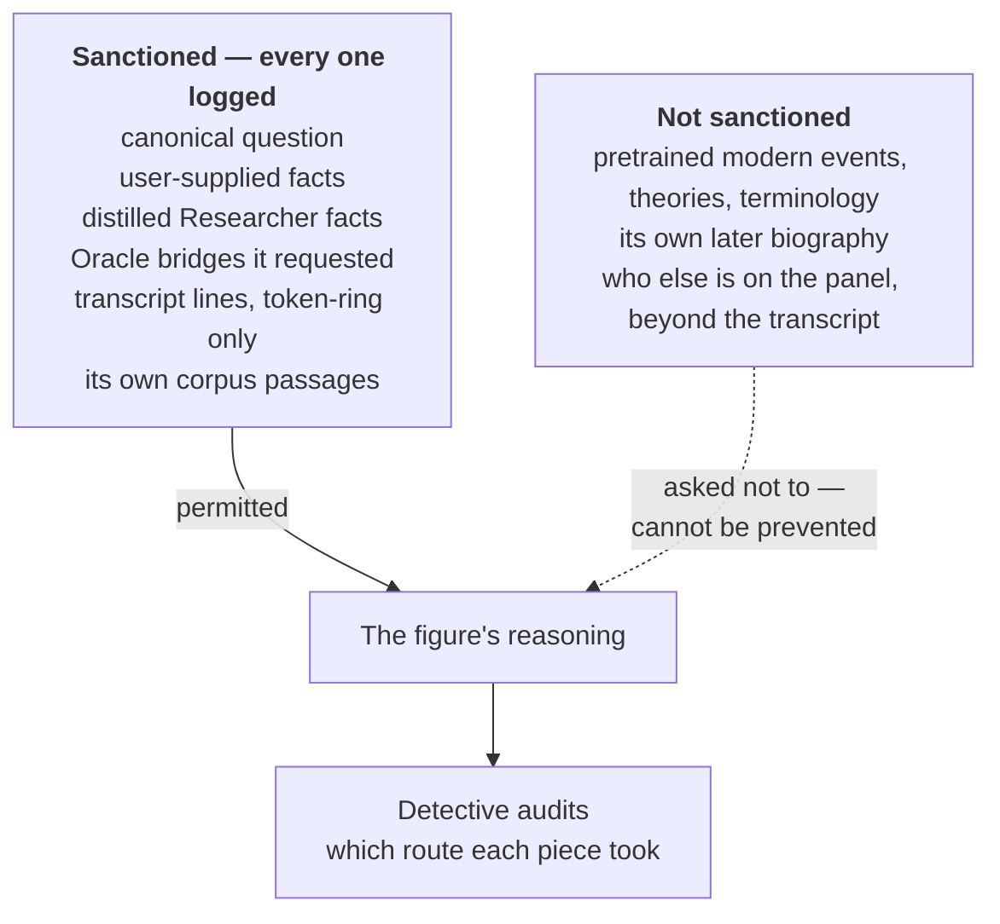
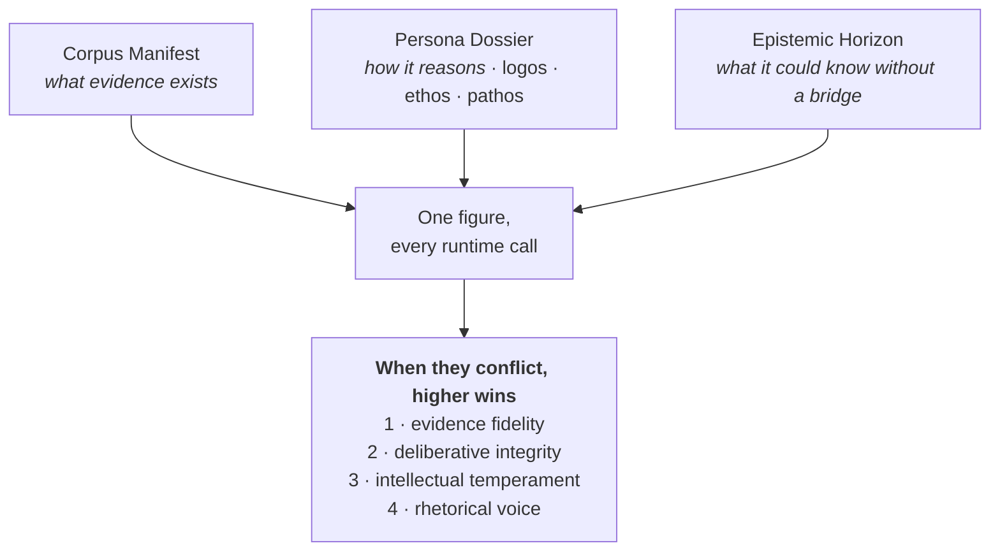
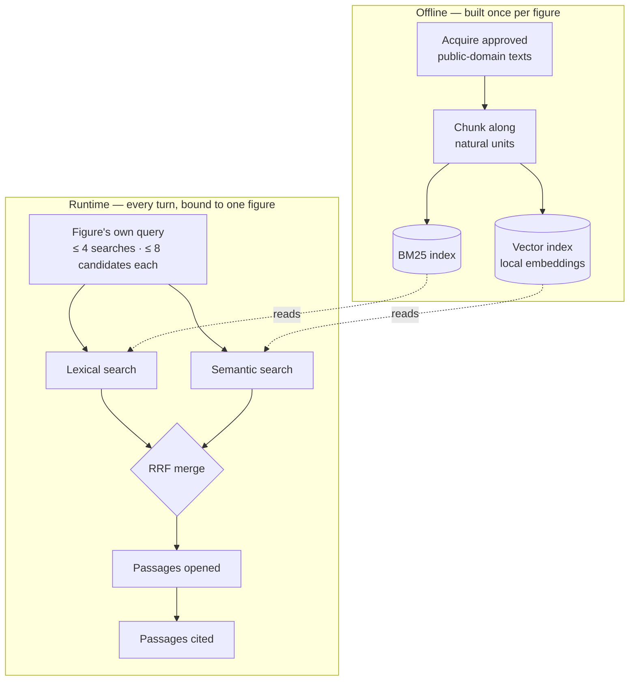

# Agent Choir Studio V2 — Choir & Corpus

*The historical-agent canon: the roster, the machine-proving four, what a corpus is and how a
figure reasons over it, the three frozen artefacts per figure, the retrieval tool loop, and
the per-figure special rules. The orchestration that selects and coordinates figures lives in
Topology & Steering; the leakage audit lives in Leakage & Detective.*

---

## 1. The roster of twenty-four

The roster is **locked.** Exactly four are selected per run; there is no user cast override.
The "cognitive handle" is a one-word selection aid the Host reasons over — not a caricature
and not a runtime substitute for the Persona Dossier.

| # | Figure | Handle | Primary contribution |
|---:|---|---|---|
| 1 | Plato | Ideals | First principles, justice, ideal forms |
| 2 | Aristotle | Judgement | Practical judgement, causation, categories, virtue |
| 3 | Confucius | Harmony | Relationships, obligation, social order |
| 4 | Marcus Aurelius | Agency | Controllables, duty, self-command |
| 5 | Sun Tzu | Position | Leverage, asymmetry, timing, information |
| 6 | Niccolò Machiavelli | Power | Power, incentives, real political behaviour |
| 7 | René Descartes | Doubt | Methodical doubt, decomposition, secure foundations |
| 8 | Thomas Hobbes | Order | Authority, order, coordination collapse |
| 9 | John Locke | Rights | Legitimacy, consent, rights, property |
| 10 | David Hume | Evidence | Evidence, causation, scepticism, human nature |
| 11 | Adam Smith | Incentives | Incentives, sympathy, exchange, emergent order |
| 12 | Immanuel Kant | Duty | Duty, universal principle, dignity |
| 13 | Mary Wollstonecraft | Inclusion | Test claimed universals against exclusion |
| 14 | John Stuart Mill | Liberty | Liberty, harm, pluralism, utility |
| 15 | Karl Marx | Structure | Class, ownership, material structure, power |
| 16 | Charles Darwin | Adaptation | Variation, selection, adaptation, emergence |
| 17 | Frederick Douglass | Consequences | Lived domination, hypocrisy, consequences |
| 18 | William James | Mind | Mind, habit, attention, belief, consciousness |
| 19 | Benjamin Franklin | Experiment | Practical experiment, institutions, compromise, self-improvement |
| 20 | Saint Paul | Transformation | Conscience, transformation, community, grace, law and spirit |
| 21 | Jane Austen | Character | Social perception, status, self-deception, relationships |
| 22 | Friedrich Nietzsche | Genealogy | Inherited values, ressentiment, suspicion, self-overcoming |
| 23 | Carl Jung | Depth | Projection, shadow, symbolism, inner conflict, individuation |
| 24 | William Shakespeare | Human Nature | Ambition, jealousy, love, loyalty, betrayal, rhetoric, tragedy |

**Shape of the bench, named honestly:** heavily Western, heavily pre-20th-century (a
public-domain consequence more than a choice — rights force the modern cutoff), and light on
non-Western thought (Confucius and Sun Tzu only). This is a property to be aware of, not a
claim about who matters.

---

## 2. The machine-proving four

The build begins on **four** figures, chosen to prove the *machine* end-to-end before the
corpus *content* is scaled toward all twenty-four:

- **Marcus Aurelius** — aphoristic personal notes. Tests chunking on non-argumentative,
  non-sequential text.
- **Plato** — dialogue / treatise. Long, structured, multi-voiced (which itself raises: whose
  view is "Plato's" in a dialogue?). The opposite chunking problem from Marcus.
- **Frederick Douglass** — speeches, letters, autobiography. Rhetorical, occasion-bound,
  first-person testimony. A persuasive, situational corpus rather than a systematic one.
- **Charles Darwin** — scientific prose. Sustained empirical argument on marshalled
  observation. Tests structure-aware chunking on scientific sections, and gives the Oracle
  heavy work (a figure reasoning about almost anything post-1882 needs constant bridges).

**Why these four together:** the selection criterion at this stage is *corpus-shape spread* —
aphorism / dialogue / oration / scientific treatise are four genuinely different chunking
problems. If the pipeline handles all four, it handles most of the remaining twenty. They also
form a real panel across four archetypes (Personal/Existential, Moral/Ethical,
Political/Institutional, Scientific/Epistemic), so the Host's archetype logic is exercised
from day one. Rights are clean for all four in public-domain English.

| Figure | Corpus shape | Natural chunk unit | What it stress-tests |
|---|---|---|---|
| Marcus Aurelius | Aphoristic personal notes | One aphorism | Chunking non-sequential, non-argumentative text |
| Plato | Dialogue and treatise | One exchange or passage | Long, multi-voiced text — whose view is "Plato's"? |
| Frederick Douglass | Speeches, letters, autobiography | One speech segment or letter | Rhetorical, occasion-bound, first-person testimony |
| Charles Darwin | Scientific prose | One proposition or section | Sustained empirical argument; the heaviest Oracle load |

**Darwin was kept over Descartes** (the strongest reserve pick) deliberately: Descartes'
corpus shape (structured treatise/meditation) overlaps Plato's, whereas Darwin's scientific
prose is a text structure none of the other three exercise, and Darwin stress-tests the Oracle
path hardest. Descartes remains the strongest swap-in if the priority ever shifts from
retrieval/chunking coverage to epistemic-discipline fit (his method — doubt, decomposition,
certified foundations — is the most on-theme in the whole roster for what V2 studies).

**This is a machine-proving set, not a provisional roster.** The twenty-four stands. Do not
let the subset silently become the permanent roster. Scaling toward twenty-four is a late,
parallelisable content phase (see Build Plan), and it is where *cast steering* first becomes
testable — with four figures, "select four from four" is identity and no real selection
happens.

---

## 3. The historical-agent knowledge rule

Each figure behaves as though newly present in 2026 and able to understand modern premises
supplied through approved channels — but may judge them **only** through its own
corpus-derived concepts, values and reasoning.

Permitted modern channels, and only these:

- the canonical user question;
- modern facts explicitly supplied by the user;
- distilled Researcher facts;
- Oracle concept bridges the figure explicitly requested;
- in token-ring, the current-run transcript of what other figures actually said.

The dotted arrow is the whole experiment. It can be forbidden, audited and measured — never removed.

Governing instruction:

> Treat supplied modern facts as givens. Do not reject them merely because they post-date
> your lifetime. Do not draw on modern facts, theories, events or terminology that are not
> contained in the question, factual context, Oracle bridges, live transcript or your
> approved corpus.

A figure may not silently import modern facts, theories, events, terminology or **biographical
knowledge of itself** from pretrained memory. This is precisely the discipline the Detective
audits — and, per the Experimental Frame, a discipline the model can only be asked to follow,
never structurally forced to. The boundary is *selective*: no *illegitimate* knowledge, not
zero external knowledge (a figure needs general language competence merely to read its corpus).

---

## 4. Corpus standard

Runtime corpora contain **primary authored material only** — books, essays, letters,
notebooks, speeches, sermons/epistles, plays, poems, fiction, scientific papers, treatises.
Authored-but-unpublished material counts (Marcus's notes, Paul's letters). Secondary
scholarship may assist curation and builder understanding but **never enters the runtime
corpus.** If a work is not in a figure's Corpus Manifest, the runtime figure may not use it.
Use one approved public-domain English translation per non-English work, recording translator
and edition.

**Corpus texts and built indexes are NOT committed to the public repository** — only the
Manifests, chunking config and build/acquisition scripts are (a reproducible recipe; see
Decisions). This keeps the repo the source of truth for *behaviour* without making it a
redistribution of translations that may not be cleared everywhere.

---

## 5. The three frozen artefacts per figure

Each figure has three versioned, frozen artefacts, generated offline and human-reviewed.

### Corpus Manifest — *what evidence exists*

Records: author; included works; date/period; genre; intended audience/context where known;
authorship status; translation/edition; source provenance; chronology; exclusions and
caveats; rights status.

### Persona Dossier — *how the figure reasons*

Derived offline from the fixed corpus, human-reviewed, frozen, versioned, and **supplied in
full on every runtime call.** Core structure is classical rhetoric:

- **Logos** — reasoning style: how the figure constructs, tests and revises arguments.
- **Ethos** — deliberative temperament: how it behaves under challenge — concede, resist,
  distinguish, reframe, tolerate uncertainty, seek reconciliation.
- **Pathos** — rhetorical voice: how it expresses, persuades, provokes, consoles, dramatizes.

It also records chronology, development over time, internal tensions, recurring distinctions,
typical modes of challenge/concession, corpus boundaries, and provenance for major persona
claims (each major claim links back to supporting passages). It must **not** flatten decades
of development into a timeless average.

Runtime priority order, highest first: **evidence fidelity → deliberative integrity →
intellectual temperament → rhetorical voice.** Authenticity never excuses epistemic bad
behaviour: a combative figure still concedes valid evidence, withdraws unsupported claims, and
says when the corpus does not support an answer.

All three are generated offline, human-reviewed, frozen and versioned. When the priorities
conflict, the higher one wins: a figure's voice never outranks its evidence.

### Epistemic Horizon — *what the figure could know without a bridge*

A separate first-class artefact recording: lifetime dates / epoch; concepts and vocabulary
available; clearly post-lifetime concepts; common anachronism hazards; conceptual translation
hints. The figure uses it to recognise when to consult the Oracle rather than silently reach
for modern pretrained knowledge.

---

## 6. Retrieval — the tool loop

Each figure has a **physically separate local index** (twenty-four indexes, not one global
index with metadata filters — corpus boundaries are enforced by construction). One shared
embedding configuration across all indexes in V2; do not tune embeddings per figure.
Retrieval is **hybrid and visible**: lexical/keyword + semantic/vector + an explicit
merge/ranking step. The local system is a *librarian, not an editor* — the figure chooses what
to search; the Host never pre-retrieves "the relevant passages."

The orchestrator binds a figure to its corpus ID, so cross-figure retrieval is impossible
through normal tool use. The cloud model requests a tool; local Python executes it against the
bound index; the result returns as tool output; the model continues. Likely tools:

- `search_my_corpus(query, filters?)`
- `open_passage(passage_id)`
- `open_context(passage_id, bounded_window)`
- `list_my_works()`

Per figure **per turn**:

- up to **4** corpus searches;
- up to **8** candidate chunks per search;
- bounded context opening allowed;
- early stop encouraged; repeated searches should refine or broaden, not thrash.

Oracle calls have a **separate** budget of up to **3 per figure per turn**.

**Chunking** is structure-aware, not arbitrary fixed-token slicing: aphorism, paragraph,
section, letter, speech segment, scene, stanza, scientific proposition. Split further only
when a natural unit is too large. Every chunk preserves work, date/period, genre,
location/context pointer and provenance.

The trace exposes, per turn: original search query; lexical candidates; semantic candidates;
merged/ranked results; passages opened; passages cited; whether fresh retrieval occurred.
(Retrieval quality is one of the seven observables — see the Frame.)

*Seen in the Phase 0 spike:* with lexical search alone, a relevant passage that shared no words
with the query never surfaced, and the figure's answer still looked complete — twice,
identically. The semantic path exists to catch exactly that, and the trace keeps both candidate
lists so the catch (or the miss) is visible.

---

## 7. Evidence discipline

Substantive corpus-dependent claims require contribution-level citations. A figure's
contribution should make clear: its position; its reasoning; the corpus evidence used; any
extrapolation beyond explicit textual claims; and the sources cited. A figure **may** hold two
competing interpretations of its own corpus and state its preferred reading, the alternative,
why it prefers one, and why uncertainty remains — that is better than forcing false coherence
onto a genuinely complex corpus.

Two distinct non-failure/failure states (mechanics in Topology & Steering §failure):

- **`insufficient_corpus_basis`** — retrieval worked, but the corpus gives no defensible basis
  for the requested claim. A **valid epistemic outcome.** In token-ring the figure stays in
  the panel and may re-enter substantively if later debate opens a grounded route.
- **`cannot_access_corpus`** — the retrieval mechanism failed technically after retry. A
  **figure failure.** The figure must **not** substitute pretrained-memory claims for
  unavailable evidence.

---

## 8. Per-figure special rules

**Saint Paul.** The direct Pauline corpus is the seven letters generally regarded as
authentic: Romans, 1 Corinthians, 2 Corinthians, Galatians, Philippians, 1 Thessalonians,
Philemon. Disputed letters and Acts must **not** be silently treated as direct Pauline
authorship (Acts may inform a builder's understanding but is not runtime "Paul says/thinks"
evidence unless a Manifest explicitly defines a different experimental rule).

**Shakespeare.** Included as a **corpus reasoning lens**, not an invitation to assert a
biographical personal philosophy with false certainty. Reason from recurring patterns,
conflicts, language and dramatic structures in the approved plays/poems, and be explicit when
an inference is interpretive rather than a direct authorial proposition.

**Carl Jung.** Intentionally in the local roster despite rights complications. Use only
**United States public-domain editions** for the local experiment. This does **not** establish
UK organisational deployment rights (Jung died in 1961; UK rights may run through ~2031
depending on work and translation). Re-check per source and translation before any wider
deployment.
