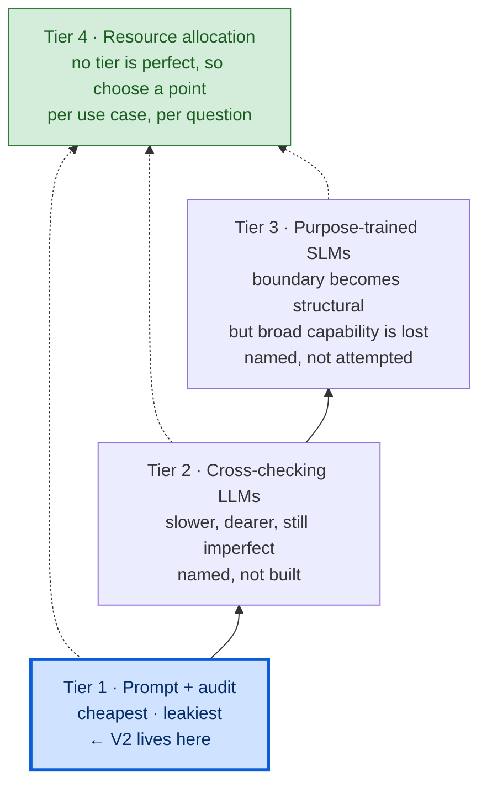
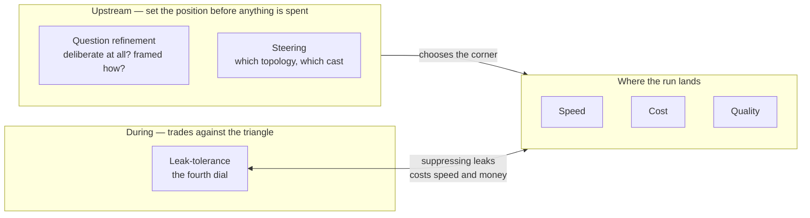

# Agent Choir Studio V2 — Experimental Frame

*The intellectual spine of V2 and the anchor document of this pack. It states what V2 is
really studying, why that matters, and the concepts everything else is organised around.
If the System, Choir and Topology documents describe the machine, this document is the
reason the machine is worth building.*

---

## 1. The one-line relationship to V1

> **V1 measured the deliberation. V2 measures the harness around the deliberation.**

V1 held one question constant and made *topology* the observable variable over an iron
triangle of speed, cost and quality. V2 lets the question be anything, and makes observable
the **intelligent envelope** that decides whether to deliberate at all, how, with whom, and
how well the reasoning stays bounded while it does.

(For the full V1 account, see `AGENT_CHOIR_LINEAGE_V1.md`.)

---

## 2. The layered purpose

V2 has a **visible mechanism** and a **deeper why**, and both are true at once.

- **Visible mechanism:** historical deliberation. Four historical figures, drawn from a
  governed roster, reason from their own primary-source corpora and argue an open question
  through one of two coordination topologies. This is the thing you watch happen on screen,
  and it is genuinely the thing happening — not a costume over something else.
- **Deeper why (the stated learning target):** *how well can evidence-discipline be imposed
  on a model that already knows these figures, and where does it leak?* Every trace is
  interpretable against this question. It is the reason the instrument earns its keep as
  preparation for real agentic systems.

These are layered, not in competition. The historical deliberation is the vehicle; the
study of bounded reasoning and its leaks is the cargo. Neither is demoted.

---

## 3. The paradox at the centre

The single most important idea in V2, and its liftable line:

> **What makes LLMs powerful reasoning tools is that they know everything. What makes them
> flawed components of a system attempting near-deterministic outcomes is that they know
> everything.**

The entire premise of a corpus-bounded historical agent — "reason only from your own
retrieved primary sources, not from what you already know about this figure" — is enforced
by *instruction and audit* against a model that structurally **cannot un-know** Marcus
Aurelius, Kant, Nietzsche or Darwin. You can detect some leakage; you cannot prevent it;
and the agent doing the detecting (the Editor, the Detective) is another instance of the
same pretrained model that also knows the figures.

This is not a defect to engineer away. **It is the subject.** V2 exists partly to make this
phenomenon observable, because it is the exact constraint that any real context-aggregation
or bounded-reasoning system inherits the moment it is built on a general LLM.

### The consequence for applied systems

Closed-loop, deterministic reasoning over *only* the information you supply is **not a
property an applied LLM has.** It is a target you engineer *toward* and never fully reach.
So the honest question is never "how do we make the model reason only from supplied
context?" — it is "how much resource do we spend narrowing the gap, and where does that
resource pay off?"

---

## 4. The four-tier mitigation hierarchy

There is no perfect way to bound a general LLM to supplied information. There are only
progressively more expensive imperfect ways. V2 studies the cheapest tier and names the
rest honestly.

1. **Prompt + audit discipline** *(what V2 does).* Instruct the model to reason only from
   sanctioned channels; audit the output for breaches afterward. Cheapest, leakiest. It is
   an instruction to a model that cannot fully comply.
2. **Cross-checking LLMs.** A separate model parses and verifies outputs before the user
   sees them. Slower, costlier, still imperfect — and partly redundant, because the base
   model's own reasoning already performs a diffuse version of this internally. You pay for
   a second pass that duplicates work the first pass did invisibly. *(Named, not built in V2
   — see the out-of-scope list in the Build Plan.)*
3. **Purpose-trained SLMs.** Train a small model on bounded material only, so the boundary
   is **structural** rather than requested. The only route that makes the boundary real —
   but it trades away the broad general-reasoning capability that made an LLM worth using in
   the first place. You do not get bounded *and* broadly capable; you pick. *(Named, not
   attempted in V2.)*
4. **Resource allocation as the actual decision.** Because no option is perfect, the real
   design act is choosing a point on accuracy vs speed vs cost — and critically, **that
   point is not global.** It is set per use case, per system, and sometimes per *individual
   question.* An eligibility check and a "help me think this through" prompt do not warrant
   the same spend on leak-suppression.

Tiers 1–3 climb in cost and in how real the boundary is. Tier 4 isn't a fourth rung; it's the
decision every rung feeds: which rung, for *this* question.

Tier 4 is the practical conclusion the whole frame drives toward, and it connects directly
to the Host (below).

**Model choice is the same decision, one level down.** The complexity rubric that steers topology
and cast could equally steer *which model* a question or seat gets — a third mapping from the same
score, needing no new machinery. That is parked, not built (Decisions A5). The build already
applies the principle to itself, though: every role starts on one cheap model, and a seat is
promoted only when its own trace shows the cheap model costing quality (Decisions H1). Spend
follows evidence, per seat — tier 4 applied to the instrument that studies it.

---

## 5. The seven observables

V2 makes seven things observable per run, in two families. This is the measurement canon.

**Quantitative — the trace reads them cleanly:**

1. **Cost** — token spend, per call, per round, per run.
2. **Speed** — latency, per call, per round, wall-clock total.

**Qualitative — a human or a model must judge them (this is where the skill lives):**

3. **Quality of outcome** — is the synthesis actually good. Carried from V1.
4. **Steering** — was the routing apt? Two halves: *topology steering* (archetype +
   complexity score → hub-and-spoke or token-ring) and *cast steering* (selecting and
   rejecting four figures from a larger field). See §8 on why only one half is testable
   early.
5. **Question refinement** — did the system correctly decide whether to deliberate at all,
   frame the canonical question well, and identify what facts were needed? Includes
   deliberation triage (§7).
6. **Leakage** — how bounded the figures stayed, and *by what mechanism* the boundary broke.
   Owned by the Detective; see `AGENT_CHOIR_V2_LEAKAGE_AND_DETECTIVE.md`.
7. **Retrieval quality** — did the figure find and cite the *right* passages, or did weak
   corpus coverage or weak rank-fusion feed it thin, tangential evidence? This is the
   substrate the entire epistemic-discipline claim rests on: if retrieval is weak, "bounded
   reasoning" is bounded to noise. It is the most novel thing V2 builds (V1 had no retrieval
   at all) and is named as a first-class observable rather than left as plumbing.
   *Already observed:* in the Phase 0 spike, word-only search missed a relevant passage and the
   answer still looked complete — twice, identically. Thin retrieval does not announce itself.

Two quantitative, five qualitative. The weight on human judgement is deliberate and
consistent with V1's principle that *quality is a human read.*

### Two things that are deliberately NOT observables

- **Topology value is observed, never scored.** Whether interaction added anything over an
  independent baseline is legible directly from the Round-1-baseline deltas the trace
  already captures (position changes, new arguments, resolved challenges). It is **not**
  collapsed into a scalar "value" metric. An invented topology-value number would be exactly
  the counterfeit-certainty trap the instrument exists to expose, one level up: a figure
  that *feels* like measurement but only launders a judgement.
- **Run-to-run consistency / self-improvement is deferred.** Each run is a closed, stateless
  island; nothing compounds. Analysing stability across many completed traces is always
  available *externally* (that is what makes statelessness worth having), but it never feeds
  back into runtime. A future experiment on the same arc may study a system's ability to
  improve from multi-run outcomes — that is a **named, consciously deferred** future build,
  not an oversight, and explicitly not this one.

---

## 6. The Host as a per-question resource allocator

The seven observables are not peers. Two of them *control* where a run lands on the iron
triangle, and one is *coupled* to it:

- **Steering** and **question refinement** happen **upstream** — they decide *whether* you
  spend anything at all and *which* topology (and cast) you commit to. They set the position
  on the triangle before deliberation begins.
- **Leakage** happens **during** and **trades against** the triangle — suppressing it costs
  speed and money (the tier-2 cross-checking option). Leak-tolerance is, in effect, a
  **fourth dial** on the same panel as speed, cost and quality.

Put together: the **Host is a per-question resource allocator.** When it scores complexity,
decides whether to deliberate, picks a topology and a cast, it is already doing exactly what
a real context-aggregation system must do — deciding, per request, how much machine to
spend. V2 makes that allocation *visible for evidence-discipline specifically.* This is the
sharpest transfer to real systems: the Host is the smallest working model of the resource
decision that tier 4 of the mitigation hierarchy names.

---

## 7. Deliberation triage — the cheapest, highest-leverage act

The single most valuable thing the system can do is **decide not to run.**

`What is 4 multiplied by 9?` does not warrant a four-figure historical deliberation. The
answer is 36, and the first reasoning model asked can simply say so. Convening the machine
for it would spend 100% of the cost and latency for zero benefit.

So "should we even deliberate?" is its own act, not a footnote to question refinement.
Every question correctly **deflected** is total cost and latency saved. Most naive systems
convene the full apparatus for everything; the discipline of *not* doing so is a first-class
capability. In the terms of a real system: don't run the orchestrator when a lookup — or a
one-line answer — will do.

The Host owns this. Its outcomes on a question include proceeding to full deliberation,
answering directly, clarifying, or reframing/rejecting. Triage sits at the very front.

---

## 8. What "leakage" actually means — and why the target is narrower than it sounds

You cannot bound a figure to *zero* external knowledge — it needs general language
competence merely to read its own corpus. So the boundary is not "no external knowledge."
It is **selective**: no *illegitimate* knowledge —

- modern facts not supplied through a sanctioned channel;
- the figure's own biography or later-life positions imported from pretraining;
- post-lifetime concepts, events or terminology the Oracle did not bridge;
- knowledge of *who else* is in the panel, beyond what the transcript reveals.

Defining what you are bounding *against* is itself a design act, and it is what makes the
Detective's audit tractable at all. The Detective is not hunting the unfalsifiable question
"did general knowledge appear" — it is hunting "did *unsanctioned* knowledge appear," which
the trace can often actually answer. (Full taxonomy and the deterministic Oracle cross-check
live in `AGENT_CHOIR_V2_LEAKAGE_AND_DETECTIVE.md`.)

### Why cast steering comes online late

Note a consequence for observable 4. On the **machine-proving four**, cast steering cannot
be exercised: selecting "exactly four from four" is identity — no discrimination, no
rejection, no near-miss. *Topology* steering works from the first run (the score rubric does
not care how many figures exist). *Cast* steering only becomes testable once the roster is
large enough to force a genuine choice — during corpus scaling toward twenty-four. That is a
**designed activation checkpoint**, not a gap; see the Build Plan.

---

## 9. The transfer to Elbereth

V2 is no longer a direct simulation of Elbereth's context-aggregation layer, as V1 was. Its
value is more general and arguably deeper. It builds first-hand competence in:

- orchestration and bounded tool use;
- deciding, per request, how much machine a question warrants;
- imposing epistemic constraints on a general model and *measuring where they leak*;
- topology choice, failure handling, and trace design as instruments of that measurement.

The concrete transfer: any real system that assembles context from an LLM inherits the
paradox of §3. It cannot achieve deterministic bounded reasoning; it can only allocate
resource, per use case and sometimes per question, along the accuracy/speed/cost surface,
with leak-tolerance as a fourth dial. V2's Host is the smallest honest working model of that
decision, and V2's Detective is the smallest honest working model of measuring how well it
held.

The code remains disposable. The judgement is the asset.
