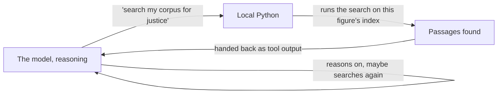
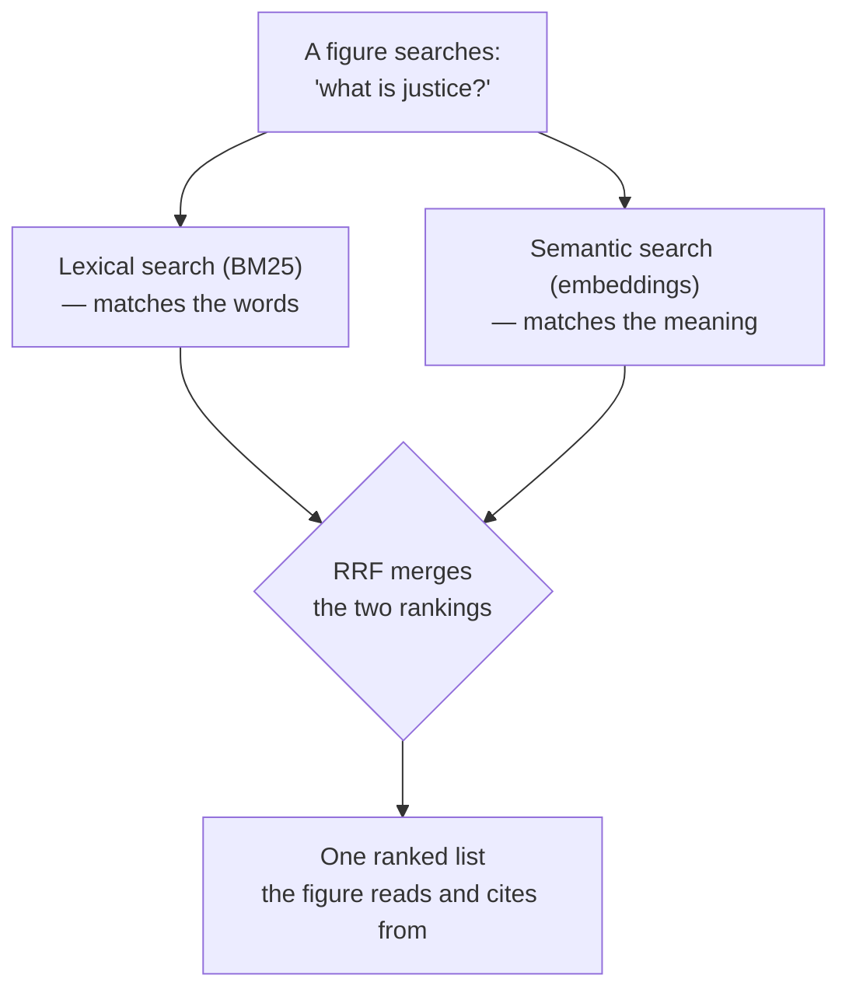

# Agent Choir Studio V2 — Glossary (Non-Technical)

*For a reader who can follow the ideas in this project but hasn't touched the plumbing — a product
owner, a domain expert, a curious colleague. Pairs with the conceptual glossary
(`AGENT_CHOIR_V2_GLOSSARY.md`), which covers the project's own vocabulary. This one covers the stack
underneath, and the retrieval machinery that is new to V2 and sits at the heart of it.*

---

## How the pieces talk

**API (Application Programming Interface).** A defined way for one piece of software to ask another
for something and get an answer back — like a menu at a restaurant. You don't need to know how the
kitchen works; you just need to know what you can order and what you'll get.

**Endpoint.** A specific address an API exposes for one kind of request. In this project, the
browser hits an endpoint to start a run.

**Request / response.** The basic unit of API conversation: something asks (request), something
comes back (response).

**SSE (Server-Sent Events).** A way for a server to push a stream of updates to a browser as they
happen, over one connection, instead of the browser repeatedly asking "anything new yet?" It is why
this project's frontend can show each figure speaking *live, in order*, rather than waiting for the
whole run to finish and dumping it all at once. With SSE you *watch the deliberation think*, one
turn at a time.

---

## What's running the code

**Uvicorn.** The program that actually runs the web server — it listens for incoming requests and
hands them to the application code. The engine.

**FastAPI.** The framework the project's own code is written in — it defines what happens at each
endpoint. What you build *with* the engine.

**asyncio.** Python's way of doing several things at once without multiple full processes — the
mechanism that lets the four figures in hub-and-spoke run in parallel rather than one at a time.

None of these three do the *thinking* — that's the model's job. They're the plumbing that gets a
request from the browser to the code that talks to the model, and the answer back.

---

## Shape and safety of data

**Pydantic.** A library that enforces a fixed shape on data — "this field must be text," "this one
is required." It guarantees each figure's output and each trace record arrives in a predictable
structure, rather than free-form text something downstream has to guess at.

**Schema.** The definition of that fixed shape — a contract for what a piece of data must contain.

**Schema version.** A stamp on each stored record saying which version of the shape it follows, so
that runs recorded weeks apart stay comparable even if the shape evolves.

**JSON / JSONL.** JSON is a common, human-readable way of writing structured data
(`{"role": "editor", ...}`). JSONL is the same thing, one JSON object per line — used here for the
live event stream, so each event can be appended without rewriting the whole file.

---

## The AI-specific bits

**Model.** The actual AI system being called. Different models have different capability and cost;
this project deliberately uses cheaper models for narrow roles (the figures, the Oracle) and stronger
models where the reasoning is hardest (the Editor, the Detective).

**Token.** The unit models read and write in — roughly a word or part of a word. Tokens matter
twice: they're what you're billed for, and they're what fills up a model's *context window* (how much
text it can consider at once). In token-ring, re-sending a growing transcript each round means the
token count — and the cost — climbs with every round.

**Tool calling (function calling).** The mechanism that lets a cloud model *ask the local program to
do something* mid-thought — here, to search a figure's corpus. The model can't reach into your
computer; instead it says "please run `search_my_corpus('justice')`," the local Python runs it against
that figure's index, and the result is handed back so the model can continue. This request-run-return
loop is the single biggest new thing in V2 versus the earlier experiment, which had no tools at all.

**API key vs subscription.** A subscription (like ChatGPT Plus) is a seat for a human to chat through
an app. An API key is separate: programmatic access, billed per token, used by *code* rather than a
person typing. This project runs entirely on API keys — no subscription is involved in what the code
does.

---

## The retrieval machinery (new to V2, and central)

The heart of V2 is letting each figure reason **only from its own body of primary sources.** That
requires being able to *find* the right passages in a large body of text on demand. Here's how that
works, in plain terms.

**Corpus.** The full body of a figure's approved primary texts — everything Marcus Aurelius actually
wrote, say. The raw material the figure is allowed to reason from.

**Chunk / chunking.** Splitting a corpus into retrievable pieces. Rather than slicing every N words
(which cuts sentences in half), this project splits along **natural units** — an aphorism, a
paragraph, a letter, a scene, a scientific section — so each retrieved piece is a coherent thought,
not a fragment.

**Index.** A pre-built structure that makes searching a corpus fast — like the index at the back of a
book, but built for a computer. Each figure has its **own separate index**, so one figure can never
accidentally search another's texts.

**Embedding / vector.** A way of turning a piece of text into a list of numbers that captures its
*meaning*, so that two passages about the same idea end up with similar numbers even if they use
different words. The "list of numbers" is called a vector. An **embedding model** is the small local
program that produces them.

**Semantic search.** Searching by *meaning*, using embeddings — it can find a passage about mercy
when you searched for "forgiveness," even though the word "forgiveness" never appears.

**Lexical search (BM25).** Searching by *actual words* — the classic keyword match. BM25 is a
standard, well-understood way of ranking documents by how well their words match the query. Good at
catching exact terms that semantic search might gloss over.

**Cosine similarity.** The specific measure used to decide how "close" two embedding vectors are —
i.e. how similar in meaning two passages are. Closer = more similar.

**Hybrid retrieval.** Using *both* searches together — lexical for exact words, semantic for meaning —
because each catches what the other misses. This project does hybrid retrieval and shows both result
lists plus the merged one, so you can see *why* a passage was surfaced.

**RRF (Reciprocal Rank Fusion).** The simple, tunable-free method used to *merge* the lexical and
semantic result lists into one ranking. It rewards passages that rank well in *either* list, without
needing to fiddle with weights or trust an opaque re-ranking model. Chosen precisely because it's
easy to explain and inspect.

The point of showing all of this in the trace is that **retrieval quality is one of the seven things
the project measures.** If a figure reasons beautifully over the *wrong* passages, that's a failure
worth seeing — and you can only see it if the search itself is laid bare.

---

## Repo mechanics

**Repo (repository).** The folder of code and its full history, tracked by git and hosted on GitHub.
The durable record of what was actually built.

**Commit.** A saved checkpoint of changes, with a message describing what changed and why. Every
commit also records *who made it* — which is how a corporate email address can end up in a public
repo's history even when it appears nowhere in the code. V2 sets a neutral commit identity from the
first commit precisely to avoid that.

**`.env` / environment variable.** A local file holding secrets (like API keys) that must never be
committed to the repo. Environment variables let the code read those secrets at runtime without them
ever appearing in the tracked code.

**Gitignored.** Files git is told to ignore — never committed, never pushed. In V2 the corpus texts,
the built indexes, the trace files and `.env` are all gitignored: they live only on the local
machine, so the public repo carries the *recipe* for building a corpus, not the texts themselves.
