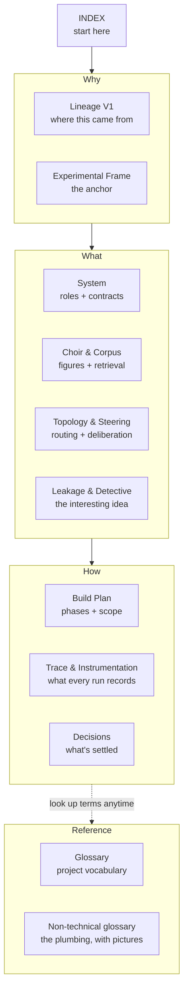

# Agent Choir Studio V2 — Index & Reading Map

*The front door to the V2 context pack. Start here.*

---

## What this pack is

This is the **complete, self-contained canon** for Agent Choir Studio V2 — an
open-question historical-deliberation learning instrument. It assumes **nothing
outside itself**: not the repository's code, not the earlier V2 draft documents, not
any prior conversation. Where earlier context is load-bearing, its substance is embedded
here directly.

If you are a fresh reader — a new Claude project, ChatGPT, Claude Code, or a human
picking this up cold — everything you need to understand *what we are building and
why* lives in these twelve files. In the repository, eleven sit in `docs/` and the
non-technical glossary sits at the repo root beside the README (Decisions I1). The
**code** is the source of truth for *behaviour*; this pack is the source of truth for
*intent, reasoning and design constraints*.

Two governing principles inherited from the first experiment and unchanged:

1. **The code is sandbox; the repository is seed.** The code will never reach
   production. The judgement built by making it is the durable asset. When context
   needs re-grounding and the repo is reachable, the answer to "what does this
   actually do" is the code. This pack answers "what were we trying to do, and why."
2. **Instrumentation is the product, not the answer.** The polished final answer a
   run produces is useful but secondary. The real object of study is the *trace* —
   orchestration choices, retrieval paths, topology effects, anchoring, revisions,
   failures, latency, cost, and epistemic discipline.

---

## What V2 is, in one paragraph

A user asks essentially any question. A governed **Host** frames it, decides whether
it is even worth deliberating (a maths question gets answered, not convened),
researches current facts when needed, classifies and scores it, then deterministically
selects exactly four historical figures from a fixed roster of twenty-four and routes
the question to one of two coordination topologies. Those four figures — the **Choir** —
reason from fixed primary-source corpora, frozen corpus-derived persona dossiers and
explicit epistemic horizons, each able to search only its own local corpus and to
consult a bounded **Oracle** when a modern concept lies beyond its lifetime. An
**Editor** audits the deliberation and synthesises a final answer without becoming a
hidden fifth voice. Finally a **Detective** reads the frozen trace and hunts for
evidence that any figure breached its epistemic bounds — the leakage of knowledge it
was not sanctioned to have. Every run is stateless, and every causal step is streamed
and recorded.

The visible narrative is deliberately simple:

> **Host → Choir → Editor → Detective**

---

## Reading order

Read in this order for a cold start. Skip freely once oriented.

| # | File | What it gives you |
|---:|---|---|
| 1 | **AGENT_CHOIR_V2_INDEX.md** *(this file)* | Orientation and the map. |
| 2 | [**AGENT_CHOIR_LINEAGE_V1.md**](AGENT_CHOIR_LINEAGE_V1.md) | The first experiment: what it was, why, what it proved, what carried forward. Skippable if you already know V1. |
| 3 | [**AGENT_CHOIR_V2_EXPERIMENTAL_FRAME.md**](AGENT_CHOIR_V2_EXPERIMENTAL_FRAME.md) | The intellectual spine — the *why*. The layered purpose, the seven observables, the knowing-everything paradox, the mitigation hierarchy, deliberation triage. The anchor document. |
| 4 | [**AGENT_CHOIR_V2_SYSTEM.md**](AGENT_CHOIR_V2_SYSTEM.md) | The *what* — roles and their contracts (Host, Choir, Editor, Detective, Researcher, Oracle), the stateless run boundary, the technology posture. |
| 5 | [**AGENT_CHOIR_V2_CHOIR_AND_CORPUS.md**](AGENT_CHOIR_V2_CHOIR_AND_CORPUS.md) | The historical-agent canon — the roster of 24, the machine-proving four, corpus standard, Manifests / Persona Dossiers / Epistemic Horizons, the retrieval tool loop, per-figure rules. |
| 6 | [**AGENT_CHOIR_V2_TOPOLOGY_AND_STEERING.md**](AGENT_CHOIR_V2_TOPOLOGY_AND_STEERING.md) | Orchestration mechanics — archetypes, complexity rubric, locked topology threshold, cast steering, hub-and-spoke, token-ring (rounds, seat rotation, direct questions/challenges, stop logic), Researcher steering. |
| 7 | [**AGENT_CHOIR_V2_LEAKAGE_AND_DETECTIVE.md**](AGENT_CHOIR_V2_LEAKAGE_AND_DETECTIVE.md) | The Detective's full spec, the hard/soft leakage taxonomy, the Oracle cross-check, `detective.json`, and the mandatory self-limitation clause. |
| 8 | [**AGENT_CHOIR_V2_DECISIONS.md**](AGENT_CHOIR_V2_DECISIONS.md) | The decision record (ADR) — every resolved implementation choice as decision + rationale + rejected alternative, plus repo-hygiene decisions. |
| 9 | [**AGENT_CHOIR_V2_BUILD_PLAN.md**](AGENT_CHOIR_V2_BUILD_PLAN.md) | The phased vertical-slice build plan, the keystone slice, trace-evidence per phase, the cast-steering activation checkpoint, and the explicit out-of-scope list. |
| 10 | [**AGENT_CHOIR_V2_TRACE_AND_INSTRUMENTATION.md**](AGENT_CHOIR_V2_TRACE_AND_INSTRUMENTATION.md) | What every run captures — raw + normalized, `schema_version`, the per-run trace directory, where each of the seven observables physically lives, the live-vs-expandable UI split. |
| 11 | [**AGENT_CHOIR_V2_GLOSSARY.md**](AGENT_CHOIR_V2_GLOSSARY.md) | Conceptual glossary — the project's own vocabulary. |
| 12 | [**AGENT_CHOIR_V2_GLOSSARY_NON_TECHNICAL.md**](../AGENT_CHOIR_V2_GLOSSARY_NON_TECHNICAL.md) *(repo root)* | Stack-literacy glossary — the plumbing, for a reader who follows the ideas but hasn't touched the machinery. |

---

The same twelve, by the question each one answers:

## If you only read three

- **New to the whole thing** → 3 (Frame), then 4 (System), then 5 (Choir & Corpus).
- **About to build** → 9 (Build Plan), then 8 (Decisions), then 10 (Trace).
- **Here for the interesting idea** → 3 (Frame), then 7 (Leakage & Detective).

---

## Status

*As of 2026-11-12.* V2 started greenfield. **Phase 0 is complete:** the repository
stands up with identity hygiene verified before commit one, a FastAPI skeleton streams
events to a vanilla page, and a live spike has proven the model → tool → model loop on
`gpt-6-luna` through the Responses API. Its findings are recorded in the Build Plan.
**Next is Phase 1, the substrate.** The Build Plan carries the live status; this
section is a pointer, not a second source of truth.

Every role currently runs on one model, with reasoning effort as the per-role dial and
promotion only on trace evidence (Decisions H1).

The roster of twenty-four is locked. The build begins on a **machine-proving four**
(Marcus Aurelius, Plato, Frederick Douglass, Charles Darwin) — enough to prove the
machine end-to-end before the corpus content is scaled toward all twenty-four. This
subset is a machine-proving set, **not** a provisional roster; the twenty-four stands.
