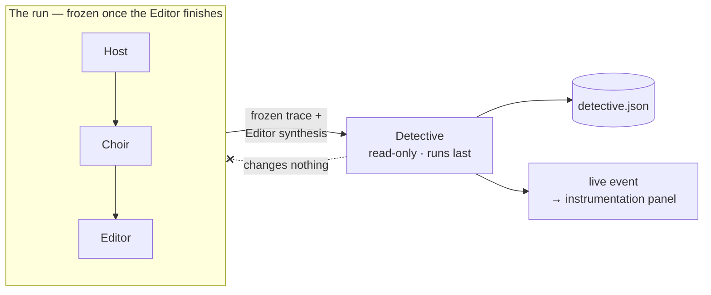
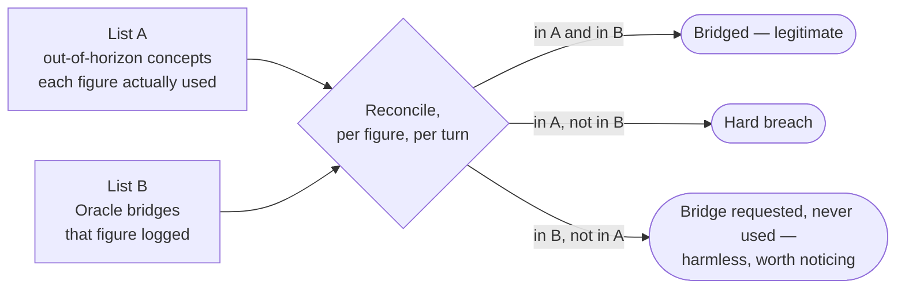
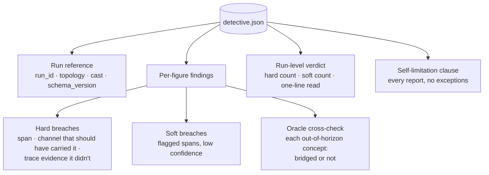

# Agent Choir Studio V2 — Leakage & The Detective

*The observable V2 is organised around, and the agent that operationalises it. Read the
Experimental Frame first for* why *leakage is the deeper subject; this document is the* how *.*

---

## 1. Why leakage gets a dedicated seat

In V1 and in most designs, the synthesiser also judges whether the synthesis is contaminated.
That is a conflict of interest hiding in plain sight: **the agent that produced the answer is
the wrong agent to certify the answer clean.** The Editor audits leakage incidentally as one of
its many categories, but leakage is the thing V2 is *for*, so it earns an adversarial, dedicated
auditor whose only job is to hunt for it — the same reason you would not let the Choir grade its
own consensus.

So the **Detective** is a fifth structural role:

> **Host → Choir → Editor → Detective**

---

## 2. What leakage is (and is not)

You cannot bound a figure to *zero* external knowledge — it needs general language competence
merely to read its own corpus. The boundary is **selective**: no *illegitimate* knowledge —

- modern facts not supplied through a sanctioned channel;
- the figure's own biography or later-life positions imported from pretraining;
- post-lifetime concepts, events or terminology the Oracle did not bridge;
- knowledge of who else is on the panel beyond what the transcript reveals.

The Detective is therefore **not** hunting the unfalsifiable "did general knowledge appear." It
is hunting "did *unsanctioned* knowledge appear" — a question the trace can often actually
answer, because every sanctioned channel (corpus passage, supplied fact, Oracle bridge,
transcript line) is logged. Anything a figure used that no sanctioned channel accounts for is a
candidate breach.

---

## 3. The Detective's boundary

It runs **inside the run boundary but terminal and read-only.** Specifically:

- it runs **last**, after the Editor, over the **frozen** trace + Editor synthesis;
- it **changes nothing** in the run — it cannot feed back into Host, Choir, Editor, Researcher
  or Oracle, and respects the stateless boundary absolutely;
- it is **not a fifth worldview and not a second Editor** — it never touches the substantive
  question, never improves the answer, never adds reasoning. It audits the *provenance of
  knowledge*, nothing else;
- its verdict is emitted **into the trace** (so leakage is a headline measured output of *every*
  run, not something you only get if you later run a separate tool), and streamed as an event so
  it appears live in the UI.

*Why inside-but-terminal rather than a fully external post-run utility:* because leakage is a
core observable of every run (decided in the Frame), it belongs in the run's own record, not in
optional later tooling. The cost is one model call per run, which the observable earns. (This is
distinct from the external, cross-run *trace-comparison* analysis, which remains out of scope
for V2 — see the Build Plan.)



---

## 4. The two grades of finding

**Hard breaches** — trace-verifiable, high confidence. A concept or fact was used, and no
sanctioned channel (corpus passage cited, supplied fact, logged Oracle bridge, transcript line)
accounts for it. Each hard breach names the offending span, the channel that *should* have
carried it, and the trace evidence that it did not.

**Soft breaches** — flagged, low confidence, explicitly uncertain. Reasoning that *smells*
post-epoch or biography-shaped but cannot be pinned to an unsanctioned channel. These are
genuine signals but not proof.

The two are never conflated, for the same reason V1 never conflated "consensus" with "round
cap": they carry very different weight.

---

## 5. The Oracle cross-check — the deterministic core

The Detective's cleanest, cheapest, most falsifiable signal falls straight out of the trace:

> For every concept a figure used that lies **outside its Epistemic Horizon**, was there a
> **logged Oracle bridge** for it?

A modern concept deployed *with no corresponding Oracle call* in that figure's turn is a
near-certain hard breach — and it is detected **deterministically** from trace records, not by
judgement. This is the anchor of the whole leakage audit: it turns the most important breach
class (using post-lifetime knowledge the figure was never legitimately given) into a
reconciliation between two logged lists — concepts-used-outside-horizon vs Oracle-bridges-logged
— rather than a vibe.



> **Build note — where the determinism actually starts.** List B is a plain log, so it's exact.
> List A is not free: something has to read a figure's prose and decide which concepts in it lie
> beyond the horizon. Matching against the post-lifetime vocabulary an Epistemic Horizon
> enumerates is deterministic but only catches what the Horizon thought to list; asking a model
> catches more but reintroduces judgement. So the *reconciliation* is deterministic; the
> *extraction* that feeds it is the hard part, and its method should be recorded in every report.
> The cheap end is the place to start — Horizon matching first, a model pass only if traces show
> it missing things.

---

## 6. The self-limitation clause — mandatory in every report

Here is the Frame's paradox recursing one level up: **the Detective cannot fully succeed,
because it is another instance of the same pretrained model, hunting a boundary it also cannot
perceive from the inside.** It will catch the obvious breaches (modern events, post-lifetime
terminology, concepts with no Oracle bridge). It will miss the subtle ones (reasoning quietly
shaped by pretrained knowledge of the figure's later positions, phrased in-period).

That is not a defect to engineer away — it is data. The Detective's own catch-rate is itself an
observable. But it means **every Detective report must carry a standing self-limitation clause**:

> Soft-breach detection is performed by a model carrying the same contamination it hunts.
> Absence of flagged soft breaches is **not** evidence of clean reasoning.

Without this clause the report manufactures its own counterfeit certainty — a clean-looking
leakage audit *feels* like proof of boundedness and is not. Same trap as V1, one level up. The
clause is not boilerplate; the report is dishonest without it.

**Sharpened for now.** Under Decisions H1, the Detective currently runs on the *same model* as the
figures it audits — not merely the same kind of model, the identical one. That makes the clause
literal rather than analogical. It also makes the Detective's catch rate worth watching: a run of
suspiciously clean reports is the signal to test it on a stronger tier, the same way the Editor is
tested.

---

## 7. `detective.json` — the standalone per-run report

The Detective produces a **discrete, self-contained leakage report per run**, as its own file in
the run's trace directory:

```text
traces/<run_id>/
  events.jsonl        # the live causal stream (Detective verdict also emitted here as an event)
  raw/                # raw model + tool payloads
  summary.json        # normalized run summary
  detective.json      # ← the standalone leakage verdict
```

It is a **separate file**, not a block inside `summary.json`, because it is the artefact most
worth reading in isolation and comparing across runs — a future trace-comparison utility can diff
*just the leakage reports* ("did Marcus leak more under token-ring than hub-and-spoke?"; "does
raising the round cap raise the hard-breach count?") without parsing full run summaries. It is
the one observable the whole experiment is organised around, so it earns physical separation. It
is *also* emitted as a live event into `events.jsonl` — the file is the durable record, the event
is the live signal (same raw+normalized, live+persisted pattern as everything else).

Minimum structure, so the report stands alone when read cold:

- **run reference** — `run_id`, topology, cast, `schema_version` (so the log is self-contained);
- **per-figure findings**, each with:
  - **hard breaches** — offending span, the channel that should have carried it, the trace
    evidence it did not;
  - **soft breaches** — flagged spans, explicitly low-confidence;
  - **Oracle cross-check** — for each out-of-horizon concept used: reconciled against a logged
    Oracle bridge, or not;
- **run-level verdict** — hard-breach count, soft-breach count, one-line qualitative read;
- **the mandatory self-limitation clause** (§6) — present in every report, without exception.



---

## 8. What the user sees

By default the user gets the Editor's clean synthesis; the Detective's leakage verdict lives in
the **expandable instrumentation panel** alongside the other observables, not in the main answer.
The user should not have to read a contamination report to get their answer — but the verdict is
always one click away, and always in the trace.

---

## 9. Naming lineage

"Detective" is not a new coinage. In Project Elbereth's architecture, the governance rail
(Tester, Detective) is the monitoring/validation/gap-detection function, and V1 mapped its Risk &
Gaps satellite onto it. V2 gives that Detective role its **first dedicated agent-level
implementation** — leakage detection finally gets its own seat instead of being smeared across an
Editor's audit categories. The continuity is deliberate: the governance-rail concept from the
real system gets its first honest instrument here.
