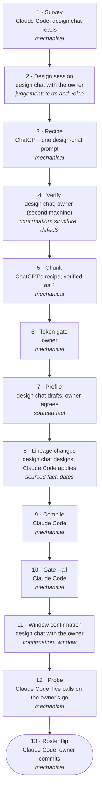

# Agent Choir Studio V2 — New Figure

*How a figure goes from chosen to `built`: the procedure, in order, and the standard every corpus
recipe meets. The corpus standard itself (what may enter a corpus) is Choir & Corpus §4; the
decisions behind the tools are Decisions K11.*

---

## 1. The procedure

**Thirteen steps, in order. Each says who does it and what kind of input the figure supplies.**
The kinds name a figure's *true delta*, what only that figure can supply:

- **judgement:** the texts and the voice;
- **sourced fact:** the profile and the dates;
- **confirmation:** structure, defects and the window;
- **mechanical:** everything else.

The true-delta principle is **planned, not yet applied to a figure**; C2 is its first use.
**Step 2 is where the texts and the voice are decided.**

| # | Step | Who | Kind |
|---:|---|---|---|
| 1 | Survey: `python -m scripts.corpus_survey <figure_id>` | Claude Code runs it on the owner's machine; design chat reads it | mechanical |
| 2 | Design session | design chat with the owner | judgement: texts and voice (edition, translation, `prompt_edition`, `reading_rule`) |
| 3 | Recipe on the kit (`corpus_kit/`) | ChatGPT, from one design-chat prompt | mechanical |
| 4 | Verify | design chat (files against report, scripts re-run); owner (second-machine hashes) | confirmation: structure and defects |
| 5 | Chunk | ChatGPT's recipe; verified as step 4 | mechanical |
| 6 | Token gate | owner | mechanical |
| 7 | Profile | design chat drafts from sources; owner agrees | sourced fact |
| 8 | Lineage changes | design chat designs; Claude Code applies | sourced fact (dates) |
| 9 | Compile: `python -m scripts.compile_horizon <figure_id>` | Claude Code | mechanical |
| 10 | Gate: `python -m scripts.horizon_gate --all` | Claude Code | mechanical |
| 11 | Window confirmation: `python -m scripts.compile_horizon <figure_id> --window` | design chat with the owner | confirmation: window |
| 12 | Probe: blind probe-question generation, then the coverage probe | Claude Code; live calls only on the owner's go | mechanical |
| 13 | Roster flip to `built` | Claude Code; owner commits | mechanical |

**Detail.**

- **The survey reports; it never decides** (K11). Its candidates go to the design session, which
  decides what the recipe strips.
- **The gate runs over every built figure** (`--all`, from the roster), because lineages are shared
  and a term added for one figure can collide with another figure's own words.
- **The window report reads the sources,** not the compiled file, and shows the figure's boundary
  for a human to confirm. It shows; it does not judge.
- **Probe questions are generated blind,** written once and never curated (Decisions E1).
- **Nothing compiled is committed until the gate passes** (Decisions K12): the pre-flight guard
  checks that a Horizon is current, not that it is free of collisions with the figure's own text.

---

## 2. The recipe standard

**Every recipe meets the same mechanical requirements.** The kit (`corpus_kit/`) provides the
mechanics; what stays in the recipe is the figure's judgement. What may enter a corpus at all is
Choir & Corpus §4 ([Corpus standard](AGENT_CHOIR_V2_CHOIR_AND_CORPUS.md#4-corpus-standard)); this
part covers recipe mechanics only.

| Requirement | The kit provides | Stays figure judgement |
|---|---|---|
| A pinned source from gutenberg.org | `source.load_pinned`: www.gutenberg.org only, checked before anything else; SHA-256 verified; CRLF to LF | Which edition, and its pinned hash (in the Manifest) |
| The envelope found exactly once | `source.envelope` | — |
| Markers located exactly once | `spans.unique` | The marker strings and the regions they bound |
| Balanced-bracket scanning | `spans.balanced` | Which brackets delimit which spans |
| A categorised ledger | `spans.Ledger`: rejects an empty span; rejects overlapping spans | The categories |
| Non-whitespace character conservation | `spans.nc` | The conserved region and its arithmetic |
| Per-category contamination terms | `spans.contamination` | The terms |
| Source defects only as exact-marker exceptions | `spans.unique` locates each marker | The exception list, one entry per defect |
| Per-figure `max_words`, set against the token gate | `chunker.split_section`, with optional abbreviation and initials exclusions; `chunker.end_check`; `chunker.word_stats`; `chunker.serialise` | `max_words` and the exclusions, in `chunking.json` |

**Recipes import the kit through one `sys.path` line,** so they keep their documented commands
(`python corpora/<figure_id>/acquire.py`).

**One exception: Marcus.** His recipe predates the ledger and the conservation check and was not
retrofitted, because doing so would be a corpus change. He uses the kit for the source and the
chunker only, with no exclusions.
