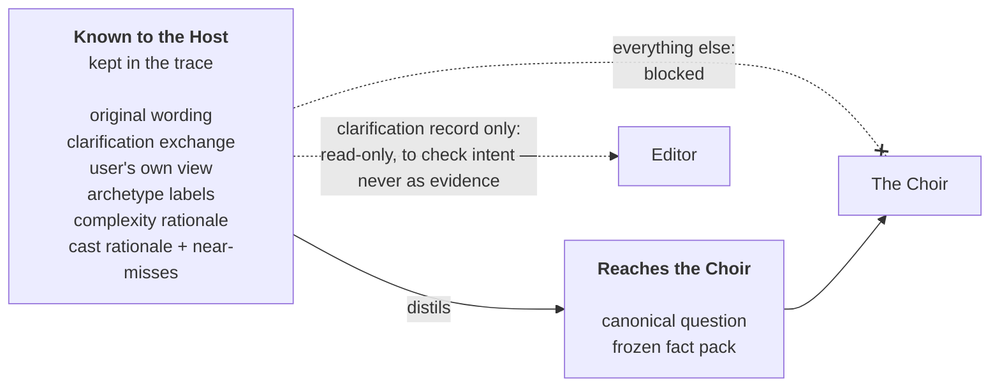
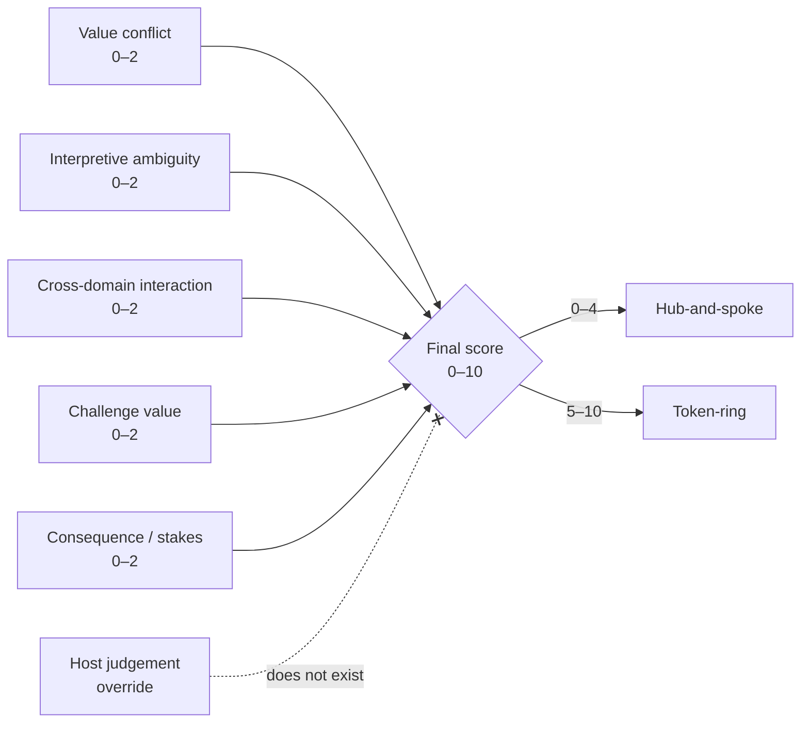
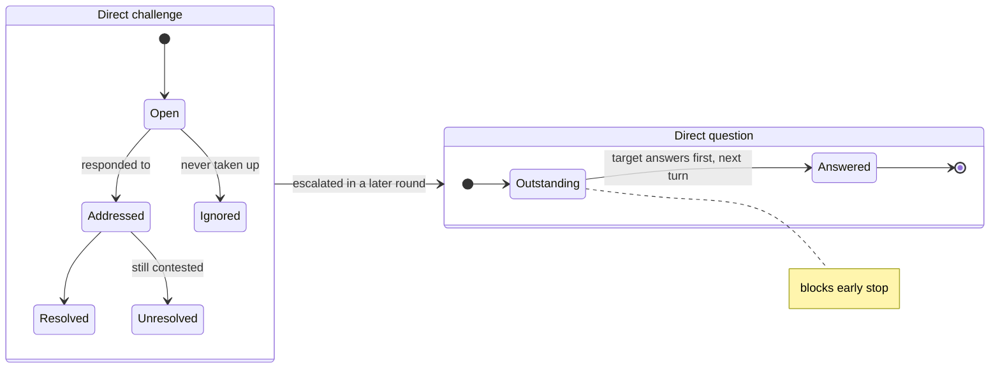
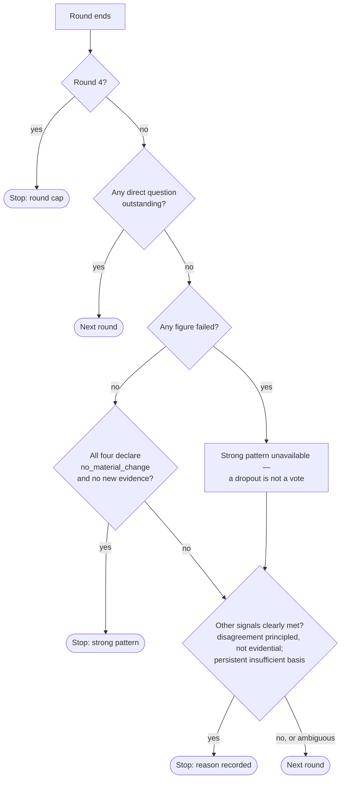
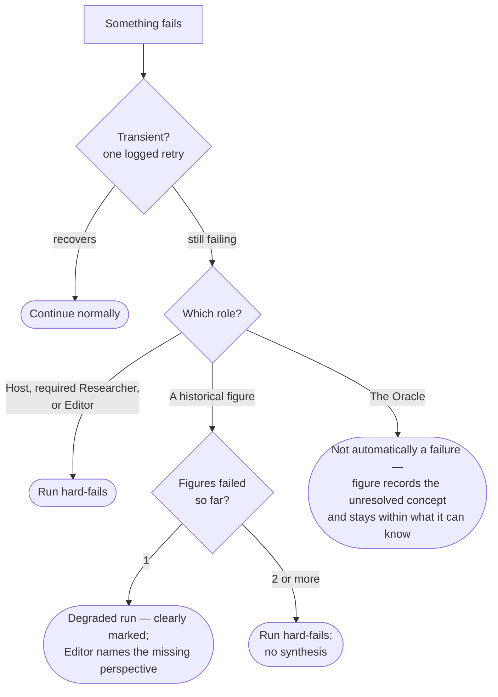

# Agent Choir Studio V2 — Topology & Steering

*The orchestration mechanics: how the Host frames, scores and routes a question, how the
Researcher is steered, and how each of the two topologies runs. Roles and their contracts are
in System; the historical agents themselves are in Choir & Corpus.*

---

## 1. Question sufficiency, triage and clarification

The Host's outcomes on a question:

- `proceed` — deliberate;
- `answer_directly` — **deliberation triage**: the question does not warrant the machine
  (a maths fact, a trivial lookup); answer it and stop. This is the cheapest, highest-leverage
  act in the system — every question correctly deflected saves 100% of its cost and latency;
- `clarify` — ask one targeted follow-up;
- `reframe_or_reject` — the question cannot be responsibly deliberated as posed.

The clarification threshold is deliberately **high.** Ask only when ambiguity would materially
change interpretation, factual requirements, cast, topology or answerability. Ask **one**
targeted follow-up at a time.

For personal, moral, strategic or contested normative questions, the Host may ask:

> **Before we go on, what do you think?**

The user's starting view may help the Host clarify intent, but it is **never** passed to the
Choir and **never** used to select a sympathetic or adversarial panel. If material ambiguity
remains after clarification, the Host asks the user to confirm the canonical interpretation
before proceeding.

The trace preserves separately: original question verbatim; clarified user context; the
user's initial position if requested; the canonical interpreted question.

---

## 2. User correction boundary

Before the Choir begins, the Host exposes its interpretation and orchestration decisions. The
user may correct **what they meant, factual premises, or omitted necessary context.** The user
may **not** override the selected **topology** or **figures.** After a valid correction, the
Host recomputes framing, research decision, scoring, topology and cast from the corrected
input, and records a visible decision delta: original interpretation, correction, revised
interpretation, score delta, topology delta, cast delta.

---

## 3. Canonical question boundary

The Choir receives **only** the canonical restated question and the frozen factual context
pack. It does **not** receive: the user's original wording as a competing prompt; the
clarification exchange; the user's initial view; Host archetype labels; Host complexity
rationale; Host cast rationale; or near-miss candidates. The original wording and clarification
record remain in the trace. The Editor may inspect the clarification record read-only (to judge
whether the synthesis answers the resolved intent) but may not treat it as deliberative
evidence.

---

## 4. Decomposition

The Host classifies the question as `single`, `compound` or `nested`. For compound/nested,
subquestions are classified and scored independently, and the whole run uses the **highest
deliberative requirement** among them. **Do not mix topologies within one run.** The Editor
preserves dependencies between nested subquestions in the synthesis.

---

## 5. Archetypes

The Host assigns exactly **one primary** and **up to two secondary** archetypes:

1. Moral / Ethical
2. Strategic / Competitive
3. Political / Institutional
4. Economic / Systemic
5. Psychological / Interpersonal
6. Scientific / Epistemic
7. Personal / Existential
8. Social / Cultural

Secondary archetypes influence cast selection but do **not** reserve seats. Relevance outranks
representational balance.

---

## 6. Complexity rubric and the locked topology threshold

Five dimensions, each scored **0, 1 or 2** (max **10**), with rationale for every dimension
visible and persisted:

1. **Value conflict**
2. **Interpretive ambiguity**
3. **Cross-domain interaction**
4. **Challenge value**
5. **Consequence / stakes**

**Locked threshold:**

- **0–4 → hub-and-spoke**
- **5–10 → token-ring**

`Challenge value = 2` is a strong signal toward token-ring *because it contributes materially
to the total* — it is **not** an override. There is **no qualitative Host override** of the
threshold. If the score produces a poor topology, that is evidence the rubric/threshold needs
changing in a future governed version — not a licence to override at runtime.

**Pre- and post-research scoring:** the Host may compute a provisional score before Researcher
work, and a revised final score if research materially changes the shape, stakes or ambiguity
of the question. The trace records initial score, Researcher intervention, final score, and the
reason for any change. **Topology is selected from the final score, before the Choir starts.**

Every dimension's score and rationale is persisted, so a poor routing can be traced to the
dimension that caused it.

---

## 7. Cast steering

The Host selects exactly four figures, model-driven within explicit criteria (not a numeric
optimizer), and must emit a structured rationale against: archetype relevance; question-specific
fit; corpus suitability; intellectual diversity; low redundancy; productive tension.

- **Corpus suitability is a gate** — a figure with genuinely weak corpus fit is not selected
  merely because it would make the debate interesting.
- **Relevance outranks engineered disagreement** — do not manufacture ideological diversity
  when it reduces relevance. All four may be relatively aligned if that is genuinely the best
  panel; if so, the Host explains why the lack of tension is deliberate.
- **Redundancy is a preference, not a prohibition** — two figures with overlapping domains may
  both be selected when their reasoning foundations differ in a materially useful way.
- **Near-miss visibility** — the Host surfaces one or two plausible near-miss candidates and
  why they were not selected.

The Host may inspect cognitive handles, dossier summaries / selection-relevant metadata, Corpus
Manifests and broad corpus-theme/strength metadata. It must **not** runtime-search all
twenty-four full corpora to choose the cast. All cast rationale is visible to user and trace,
**never** to the Choir.

*Note:* cast steering is only genuinely exercised once the roster is large enough to force a
choice; on the machine-proving four it is degenerate (four from four). The selection machinery
is still built and logged early — it just has nothing to reject until roster scaling. See the
Build Plan's activation checkpoint.

---

## 8. Researcher steering

The Host controls Researcher use. It classifies the question's factual posture:
qualitative/normative and sufficiently grounded; quantitative with sufficient data;
quantitative missing material inputs; mixed; gaps the user can supply; gaps requiring external
research; unknowable/speculative gaps. **Never fabricate missing quantitative premises.**

**Pre-panel budget:** up to **3 focused research queries**, each tied to a specific factual
gap — the Researcher searches the gaps, not "the whole debate."

**Source hierarchy, claim-by-claim:** (1) primary source; (2) authoritative institutional
source; (3) high-quality secondary; (4) Wikipedia/reference; (5) general web. Wikipedia may
orient or help discover sources; it is not a universal authority. For each material fact record
where practical: claim; source; supporting extract; source type; why selected; date;
corroboration; contestation/methodological caveat. Credible disagreement between sources is
passed through **explicitly**, not reconciled into false certainty.

**What the Choir receives:** a distilled factual context pack of **facts and uncertainty** —
not the Researcher's narrative or framing. The user sees the factual pack before deliberation;
the substrate then **freezes.**

**Exceptional token-ring intervention:** hub-and-spoke has no mid-run research. Token-ring
normally keeps the frozen pack, but may allow **one exceptional bounded Researcher
intervention** if a genuinely material empirical dependency emerges mid-debate. The Host
approves it; new facts are appended transparently; all four figures see the same appended facts
from then on; the trace marks that the factual substrate changed mid-run. Researcher and Oracle
never invoke each other.

---

## 9. Hub-and-spoke topology

Exactly four figures reason **independently, once each.** Each receives: the canonical
question; the same frozen factual context; its own full Persona Dossier; its own Epistemic
Horizon; its own corpus tools; its own private Oracle. No figure knows who else was selected; no
figure sees any other output; there is no second pass; the Researcher is pre-panel only. The
four independent contributions are persisted as the run's **independent baseline.** Outputs then
go to the Editor.

---

## 10. Token-ring topology

Exactly four figures deliberate for up to **four rounds** (a cap, not a target; reasoned early
termination is allowed). Every non-failed figure speaks in every round until termination/cap.

**Round 1 is blind** — the independent baseline. Each figure sees only its own runtime context
(canonical question, factual context, its own dossier, horizon, corpus tools, Oracle). It does
**not** know the other figures' identities and does not see their Round 1 contributions before
producing its own. All four Round 1 positions are persisted as the baseline.

**Rounds 2–4:** each figure sees the full transcript so far; speaker names become visible
because they appear in it. A figure may respond only to what another figure **actually said** —
not to pretrained/biographical knowledge of that figure as a shortcut. Direct address by name
and short transcript quotations are allowed. A figure may re-search its own corpus in response
to the debate.

**Deterministic seat rotation.** The ring direction is fixed, but persona-to-seat assignment
rotates each round to distribute first/last-speaker bias:

| Round | Seat 1 (first) | Seat 2 | Seat 3 | Seat 4 (last) |
|---|---|---|---|---|
| R1 | A | B | C | D |
| R2 | B | C | D | A |
| R3 | C | D | A | B |
| R4 | D | A | B | C |

Across a full four rounds, every figure occupies every seat exactly once.

The token moves around the same ring; what changes is who occupies each speaking position. Seat
order is persisted for every round.

### Turn state

Each historical turn exposes structured state, not only prose: corpus-grounded argument;
response to another figure; concession/revision; unresolved disagreement; sources cited; fresh
corpus retrieval; Oracle usage; direct question(s); direct challenge(s). From Round 2 onward,
each turn must explicitly declare one or more of:

`changed_position` · `refined_position` · `new_argument` · `new_evidence` ·
`direct_challenge_remains` · `no_material_change` · `insufficient_corpus_basis`

If the true state is no material change, the figure must say so (this is required for
deterministic stop logic). Any declared movement, refinement or withdrawal must record **why**
(new corpus evidence, another figure's argument, Oracle clarification, an unsupported prior
claim, a missed distinction). **Only the figure itself may declare its own change of mind** —
others and the Editor may observe inconsistency or narrowing but may not infer internal change
on its behalf. A figure may explicitly withdraw an earlier claim.

---

## 11. Direct questions and direct challenges

Two **distinct** structured objects.

**Direct question** — a procedural obligation:

- max **one outstanding** direct question per figure at a time;
- the addressed figure must answer it **first** on its next turn;
- any outstanding direct question **blocks early termination.**

**Direct challenge** — visible unresolved contention, no hard response obligation:

- max **two unresolved** direct challenges per figure at a time;
- may be converted into a direct question in a later round;
- influences stop assessment but does **not** itself hard-block termination.

| | Direct question | Direct challenge |
|---|---|---|
| What it is | A procedural obligation | Visible, unresolved contention |
| Limit per figure | One outstanding | Two unresolved |
| Must the target respond? | Yes — **first**, on its next turn | No hard obligation |
| Blocks early termination? | **Yes** | No — but weighs on the stop assessment |
| Can become the other? | — | Yes, a challenge can be escalated to a question later |

At the stop, the Editor reads each challenge's end state — ignored, addressed-but-unresolved, or
resolved — rather than treating them as one category.

A figure in `insufficient_corpus_basis` may still ask a genuinely exploratory direct question.
At termination, the Editor distinguishes ignored challenges, addressed-but-unresolved
challenges, and classifies unresolved disagreement as empirical, normative/principled or mixed.

---

## 12. Token-ring termination

**Do not equate consensus with truth.** Use deterministic signals first; use narrow model
adjudication only when signals are genuinely ambiguous (and prefer discovering that need
empirically to building a large stop-controller up front). Signals:

- no materially new argument in the latest round;
- no unresolved direct question requiring response;
- no substantial revision;
- no new corpus evidence materially changing the debate;
- remaining disagreement is clearly value/principle-based rather than further-resolvable;
- persistent `insufficient_corpus_basis` where appropriate.

A particularly strong stop pattern: **all four figures declare `no_material_change`, no
outstanding direct question exists, no materially new evidence was introduced.**

> **Guard the V1 failure-masking trap.** A *failed* figure must count as **not** a
> `no_material_change` vote. In V1, a failed/silenced satellite was treated as agreement,
> letting the system manufacture the appearance of consensus out of an agent's inability to
> object. The stop logic must never count a failed figure toward the "all four agree" pattern —
> a three-way agreement plus one silenced dropout is **not** consensus.

The stop check after each round from Round 2, with the guard built in:

If ambiguous cases turn out to matter in practice, a narrow model adjudicator can be added at the
"ambiguous" branch (Decisions C2) — only once the traces show it is needed.

Persist an explicit stop reason, e.g. *"Stopped after Round 3: positions stabilised; remaining
disagreement is principled, not evidential."* Unresolved challenges may legitimately remain at a
valid stop.

---

## 13. Round 1 baseline and topology-value instrumentation

Token-ring Round 1 is persisted as an explicit independent baseline; hub-and-spoke's four
independent contributions are persisted under the same baseline concept. For token-ring, derive
observable post-baseline deltas: material position changes after Round 1; refinements; new
arguments/evidence after Round 1; interaction-triggered corpus searches; direct questions
asked/answered; challenges raised/resolved/ignored; unresolved disagreements remaining; rounds
completed; early-stop reason; context growth; latency and cost by round.

**Do not collapse these into a fake scalar quality score.** Topology value is *observed* from
these deltas, never *scored* (see the Frame — an invented value metric would be counterfeit
certainty one level up). The Editor adds a short qualitative judgement on whether interaction
created value beyond the baseline, and must distinguish a *bad topology choice* from a
*reasonable choice that simply produced little added value on this execution.*

---

## 14. Failure and degraded-run behaviour

One automatic retry for transient API/tool failure; every retry logged. **Do not silently
retry weak reasoning or malformed substance until it "looks good."**

**Historical figures:**

- 0 failed → normal;
- 1 failed → degraded (clearly marked); the Editor still synthesizes from remaining valid
  material and states the missing perspective;
- 2+ failed → run hard-fails; no Editor synthesis.

If a figure fails after valid earlier token-ring contributions, those earlier contributions
remain in the transcript and trace; the figure is marked failed from that point onward.

**Structural roles:** Host, required Researcher, and Editor failure (after retry) each hard-fail
the run.

**Corpus / Oracle distinctions:** `cannot_access_corpus` → figure failure (no pretrained
fallback). `insufficient_corpus_basis` → valid epistemic outcome, not a failure. Oracle
technical failure → **not** automatically a figure failure; the figure may continue only if it
explicitly records the unresolved concept and stays within what it can legitimately understand.
